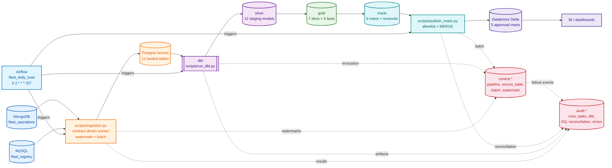
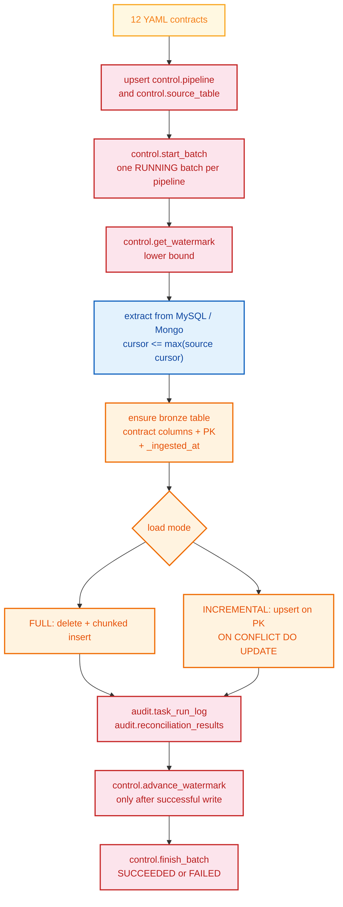
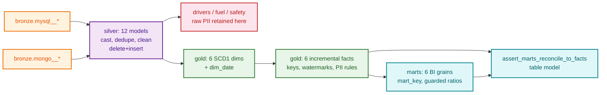
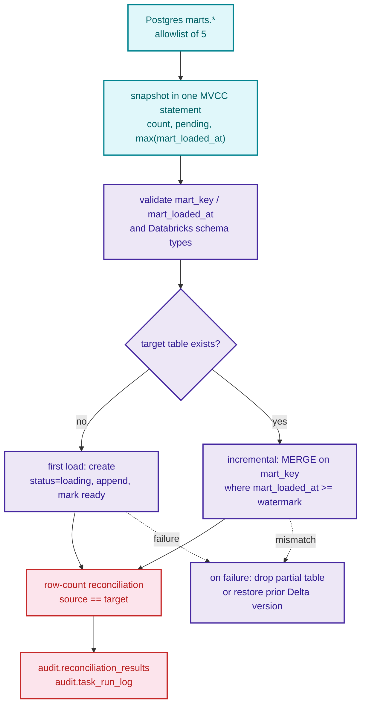
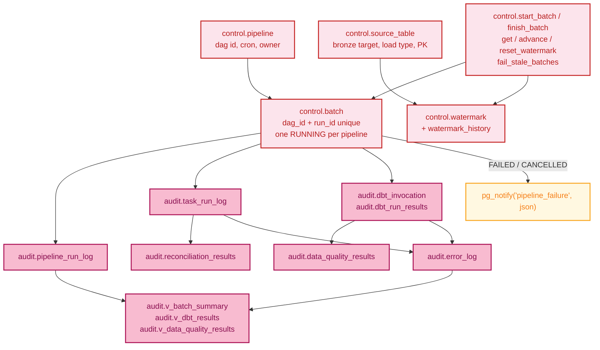
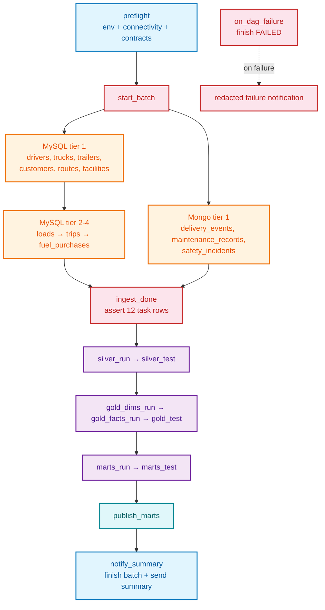
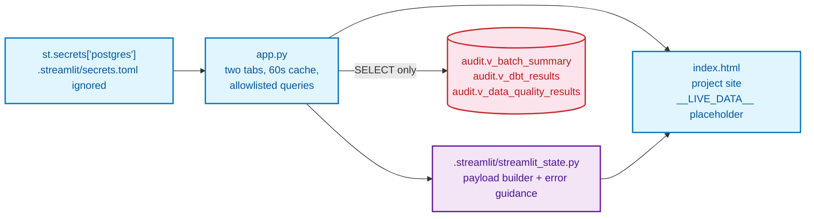

# Architecture — fleet dbt warehouse

**Purpose:** Define the authoritative design, ownership, and failure model of the daily warehouse.

**Audience:** Engineers, reviewers, and operators changing the pipeline or its contracts.

[Root README](README.md)

Blueprint of the daily fleet warehouse: what each component is, why it exists, how data and control flow through it, and what is owned by whom. `DEPLOYMENT.md` describes how this design is built, shipped and run.

---

## 1. Purpose and design principles

The warehouse turns two operational source systems into governed, reusable BI marts. Every rule below is enforced by code, contract or CI check.

| Principle | Implementation |
|---|---|
| dbt owns all transformation | SQL lives in `dbt/models`; Python only extracts, loads, publishes and audits. No transformation in ingestion, stored procedures or the sync job. |
| Raw history is preserved at one boundary | `bronze` is written only by ingestion/fixture loading; dbt reads it through `{{ source('bronze', …) }}` and never writes to it. |
| Contracts guard every boundary | `contracts/sources/*.yml` defines source columns, types, keys, extraction mode, freshness and expected counts. Ingestion enforces them at runtime; `make contracts-check` checks index/name alignment. |
| Every step is safe to run twice | Incremental upserts on business keys, dbt `delete+insert` with unique keys, watermark reprocessing windows, MERGE-based publishing, batch upserts. |
| Dev and CI never touch production schemas | `ci` prefixes layer schemas with `DBT_SCHEMA_PREFIX`; fixture loading refuses databases outside `fleet_dev`/`fleet_it_*`; production needs `ENV=prod CONFIRM=yes`. |
| Failures leave evidence | `control.batch` holds run state; `audit.*` holds append-only task, dbt, DQ, reconciliation and error records; `pg_notify('pipeline_failure', …)` fires on batch failure. |
| Sensitive data stops at a layer | PII is retained only in `bronze`/selected `silver` models, hashed/masked or dropped in `gold`, and excluded from the Databricks publication allowlist. |

---

## 2. Technology stack

| Area | Technology | Version / pin | Role in the design |
|---|---|---|---|
| Source systems | MySQL `fleet_registry`, MongoDB `fleet_operations` | read-only credentials | 9 relational tables and 3 document collections. |
| Source access | SQLAlchemy + PyMySQL, PyMongo | from `uv.lock` | Contract-driven extraction; the ingestion layer is Python, not dlt. |
| Landing / warehouse | PostgreSQL 16 | `postgres:16` in CI and Compose | `bronze`, `silver`, `gold`, `marts`, `audit`, `control` schemas in one database. |
| SQL bootstrap | `psql` + versioned SQL files | `sql/scripts/01..07` | Creates schemas, audit/control tables, functions, triggers, views and failure events. |
| Transformation | dbt Core + dbt-postgres | `>=1.12.7` / `>=1.11.0` | Models, tests, macros, docs and artifacts; the only transformation engine. |
| dbt package | `dbt-labs/dbt_utils` | `>=1.3.0,<2.0.0` | Shared macros; locked in `dbt/package-lock.yml`. |
| Serving copy | Databricks SQL Warehouse + Delta tables | `databricks-sql-connector[pyarrow]>=4.6` | Read-only BI copy of five approved marts. |
| Orchestration | Apache Airflow 3.3.2, Task SDK, CeleryExecutor | `AIRFLOW_VERSION=3.3.2` | Schedules and observes; never transforms data. |
| Queue / metadata | Redis 7.4-alpine, PostgreSQL 16 | Compose services | Celery broker and Airflow metadata DB. |
| Packaging | `uv` + `uv.lock`, Python 3.12/3.13 | `.python-version` 3.12; image builds 3.13 | Reproducible local, CI and container dependencies. |
| Containers | Docker, Docker Compose, GHCR | multi-stage-style single Airflow image | One immutable image per commit, `sha-<commit>` tag, deployed by digest. |
| Delivery | GitHub Actions, `make`, `bash`, OpenSSH | pinned action SHAs | CI gates, image build, staging auto-deploy, manual production deploy. |
| Quality | pytest, ruff, gitleaks, dbt tests | gitleaks 8.30.1 | Unit/integration/smoke tests, lint/format, secret scanning. |
| Presentation | Streamlit, pandas, SQLAlchemy | `streamlit==1.67.0` in `requirements.txt` | Read-only project site and live audit panel; no warehouse writes. |
| Config / docs | YAML, JSON, Mermaid, Markdown | `.env.example` | Single source of config knobs, contracts index and living blueprints. |

---

## 3. System context

The control/audit plane is cross-cutting: it is written by Python and SQL functions, not by dbt models, and it is never published to Databricks.

---

## 4. Ownership matrix

| Layer / schema | Platform | Written only by | Read by |
|---|---|---|---|
| `bronze` | Postgres | `scripts/ingestion.py`, `scripts/load_fixtures.py` | dbt, control/audit queries |
| `silver` | Postgres | dbt | dbt gold |
| `gold` | Postgres | dbt | dbt marts, controlled analyst access |
| `marts` | Postgres | dbt | publish job, analysts |
| Databricks `marts` copy | Databricks | `scripts/publish_marts.py` only | BI |
| `control` | Postgres | `control.*` functions, ingestion, Airflow, dbt runner | Airflow, Python, operators |
| `audit` | Postgres | `utils/audit.py`, `utils/dbt_audit.py`, SQL triggers | Airflow summaries, operators |
| Airflow metadata | Postgres | Airflow only | Airflow UI |
| Streamlit presentation | Streamlit Cloud / local | none; `app.py` only reads three `audit` views | Operators and project visitors |

Never write to a layer you do not own. `bronze` is read-only to dbt; the Databricks copy is read-only to everything except the publish job.

---

## 5. Data plane

### 5.1 Contract boundary

`contracts/` is the source of truth for the source → bronze boundary:

- `contracts/sources/*.yml` — 12 contracts: 9 MySQL (`customers`, `drivers`, `facilities`, `fuel_purchases`, `loads`, `routes`, `trailers`, `trips`, `trucks`) and 3 MongoDB (`delivery_events`, `maintenance_records`, `safety_incidents`). Each declares `source`, `landing_table`, `primary_key`, `extraction` (mode, cursor, lookback), typed columns with Mongo `staged_type`/`cast`, FKs, accepted values, row-count baseline/tolerance and freshness.
- `contracts/samples/*.sample.json` — representative payloads used by the fixture path.
- `contracts/sources_index.json` — machine-readable index of contract file, source and baseline count.
- `dbt/models/bronze/sources.yml` — the only dbt source declaration; mirrors the 12 landing tables without a hard-coded database.

`make contracts-check` compares the index, contract files, dbt source names and landing table names. Runtime ingestion additionally validates source columns, bronze schema, primary keys, identifiers and extraction mode against each contract.

### 5.2 Ingestion

| Aspect | Behaviour |
|---|---|
| Extraction | MySQL `SELECT <contract columns>` with optional `cursor > lower AND cursor <= upper`; Mongo collection projection with `$gt`/`$lte` bounds and contract columns only. Upper bound is `MAX(cursor)` at read time. |
| FULL load | `DELETE FROM bronze.<target>` then chunked inserts; watermarks are ignored. |
| INCREMENTAL load | Chunked `INSERT … ON CONFLICT (<pk>) DO UPDATE` (or `DO NOTH` when nothing is updatable); the key is the contract primary key. |
| Watermark | Lower bound from `control.get_watermark`, upper bound from the source, advanced via `control.advance_watermark` only after bronze write and reconciliation succeed; regressions are rejected. |
| Idempotency | Re-running the same window upserts the same keys, refreshes `_ingested_at` and leaves data unchanged in value. |
| Batch | Airflow supplies dag id/run id; standalone scripts open their own `fleet_daily` batch. Only one `RUNNING` batch per pipeline is allowed. |
| Audit | One `audit.task_run_log` row per landed table, reconciliation rows for counts, `audit.error_log` on failure. |
| Fixture path | `scripts/load_fixtures.py` lands `contracts/samples` through the same bronze writer under `FIXTURE_LOAD=1` and a dev/throwaway database guard; it does not run live extraction or watermark advancement. |

### 5.3 dbt transformation

dbt is structured as a strict funnel: one silver model per bronze table, a conformed star schema in gold, then denormalised BI marts.

| Layer | Models | Materialisation | Responsibility |
|---|---:|---|---|
| `silver` | 12 | `incremental` / `delete+insert`, `unique_key` = source PK, `on_schema_change: append_new_columns` | Rename, `try_cast` Mongo strings, normalise flags, dedupe by latest `_ingested_at`/`loaded_at`, clean blank text and invalid dates. No joins or business logic. |
| `gold` | 13 | 7 dimension tables + 6 incremental facts | Conformed business keys via `gold_key()`/`gold_date_key()`, Unknown member `-1`, SCD1 overwrite, PII hash/mask, fact watermarks. No SCD2 history. |
| `marts` | 7 | 6 incremental marts + 1 reconciliation table | Denormalised grains keyed by `mart_key`, additive measures, `NULLIF`-guarded ratios, `mart_hash` change detection, `mart_loaded_at` for publishing. |

`dim_date` is generated from `gold_date_start`/`gold_date_end` with an Unknown row. Facts join to the current SCD1 dimension row; there is no validity-date SCD2 join in the current implementation.

Macros and variables:

| File | Group | Purpose |
|---|---|---|
| `macros/cleaning.sql`, `clean_boolean.sql` | `clean_string`, `clean_date`, `clean_timestamp`, `clean_boolean` | Normalise blanks, empty dates and common boolean spellings. |
| `macros/bronze_incremental_filter.sql` | `bronze_incremental_filter()` | Silver reprocesses bronze rows from `max(_ingested_at) - silver_lookback_hours`. |
| `macros/generate_schema.sql` | `generate_schema_name` | CI prefixes custom schemas; other targets use the custom schema verbatim. |
| `macros/gold_helpers.sql` | `gold_key`, `gold_date_key`, `gold_unknown_key`, `gold_hash_pii`, `gold_mask_tail`, `gold_watermark` | Surrogate keys, Unknown member, PII handling, fact reprocessing window. |
| `macros/marts_helpers.sql` | `mart_key`, `mart_hash`, `mart_ratio`, `mart_month_key`, `mart_watermark` | Mart identity, dimension-change detection, safe division, incremental window. |

| Variable | Default | Used by |
|---|---:|---|
| `silver_lookback_hours` | 24 | Bronze incremental filter in all 12 silver models. |
| `gold_lookback_hours` | 3 | `gold_watermark()` in all six facts. |
| `gold_date_start` / `gold_date_end` | `2015-01-01` / `2035-12-31` | `dim_date` range. |

Fact/mart reprocessing is deliberately wider than a single run: a late bronze arrival or a changed silver row is re-keyed and propagated forward through `silver_loaded_at` → `gold_loaded_at` → `source_gold_loaded_at` → `mart_loaded_at`.

### 5.4 Mart publication

- Published: `mart_sales_daily`, `mart_equipment_utilization_daily`, `mart_delivery_performance_daily`, `mart_customer_service_monthly`, `mart_truck_cost_monthly`.
- Not published: `mart_driver_scorecard_monthly` (carries a driver display name), `assert_marts_reconcile_to_facts` (not a mart).
- The publisher requires a `mart_key` and a non-null `mart_loaded_at` timestamp, maps Postgres types to Databricks types, and blocks on target schema drift.
- Retry safety comes from the inclusive watermark and MERGE key; a failed first load is dropped, and a failed incremental load restores the captured Delta version.

---

## 6. Control and audit plane

Control answers *what is running and from where*; audit answers *what happened and can it be trusted*. They are separate concerns and separate schemas.

| Object group | Examples | Why it exists |
|---|---|---|
| Registry | `control.pipeline`, `control.source_table` | Names the daily pipeline, its cron/owner and every landing table with load type, PK and watermark type. |
| Batch state | `control.batch`, `start_batch()`, `finish_batch()`, `fail_stale_batches()` | Correlates Airflow run ids with warehouse work and prevents overlapping runs of the same pipeline. |
| Watermarks | `control.watermark`, `watermark_history`, `get_watermark()`, `advance_watermark()`, `reset_watermark()` | Supports at-least-once extraction with auditable advances and explicit resets. |
| Append-only evidence | `audit.pipeline_run_log`, `task_run_log`, `dbt_run_results`, `data_quality_results`, `reconciliation_results`, `error_log`, `dbt_invocation` | Immutable evidence for runs, tasks, dbt nodes, tests, counts and errors; triggers block UPDATE/DELETE/TRUNCATE. |
| Failure propagation | `audit.log_task_failure()`, `control.notify_batch_failure()` | Deduplicates error rows and emits `pg_notify('pipeline_failure', …)` for failed batches. |
| Views | `audit.v_batch_summary`, `v_dbt_results`, `v_data_quality_results` | Read-only rollups for operators and Airflow summary notifications. |

`utils/audit.py` writes task, DQ, reconciliation and error rows; `utils/dbt_audit.py` maps dbt `manifest.json`/`run_results.json` into `audit.dbt_invocation`, `audit.dbt_run_results` and `audit.data_quality_results`. The dbt audit step is best-effort: if it fails, the dbt exit code still decides success.

---

## 7. Orchestration

| Property | Value |
|---|---|
| DAG | `fleet_daily_load`, `0 2 * * *` `Asia/Kolkata` (02:00 IST = 20:30 UTC previous day), `start_date 2025-01-01`, `catchup=False`, `max_active_runs=1`, `dagrun_timeout=6h`. |
| DAGs paused at creation | Yes; unpausing is a deliberate manual operations step. |
| Ingestion tasks | 2 retries, 5→30 min exponential backoff, 45 min execution timeout, pools `mysql_pool`/`mongo_pool`. |
| dbt tasks | No automatic retry, 60 min timeout, strict `run` → `test` stage ordering. |
| Publish task | 1 retry with 10 min delay, 90 min timeout. |
| Failure handling | Task failures log to `audit.error_log` via SQL triggers; DAG failure closes the batch as `FAILED`, emits `pg_notify`, and sends one redacted notification. |
| Other DAGs | `fleet_report_weekly` (weekly) and `fleet_watchdog` (every 15 min) are intentional skeletons that raise `NotImplementedError`. |
| Design intent not yet wired | Airflow asset keys from the dbt manifest and scheduled `control.fail_stale_batches()` are not implemented; DAG dependency is task-based cron. |

All commands are built as argv arrays (`uv run --no-sync python scripts/<name>.py …`) with identifier validation and no shell interpolation; dbt commands add `--target`, `--select`, `--indirect-selection cautious` and explicit exclusions.

---

## 8. Streamlit project site

`app.py` is an observer, not a pipeline step. It serves `index.html` as the project front door and adds a read-only audit panel; it never writes to Postgres, Databricks or any warehouse layer.

| Component | Location | Responsibility |
|---|---|---|
| Host | `app.py` | Renders the site and live tabs, validates the fixed `VIEWS` allowlist, caches reads for 60 seconds and redacts audit-read failures. |
| Payload helper | `.streamlit/streamlit_state.py` | Builds the embedded JSON from the three rollup views, fails closed to empty data, escapes `<` and maps non-finite floats to `null`. |
| Static site | `index.html`, `assets/logo/` | Holds the Mermaid pipeline diagram and documentation links; the placeholder is replaced at render time. |
| Credentials | `st.secrets["postgres"]` | Supplies read-only Postgres credentials in Streamlit Cloud or the ignored `.streamlit/secrets.toml` locally. |

- The live panel exposes run, dbt and data-quality evidence only; no bronze, silver, mart, source or PII rows are queried.
- Missing secrets or a failed audit read produces an empty payload plus a safe, actionable message; the page still renders.
- `make streamlit` is the local launcher; Streamlit Cloud runs the same `app.py` without a separate transformation path.
- The site is not an Airflow asset and does not gate the daily batch.

---

## 9. Security and sensitive data

| Value | Where it may exist | Required handling |
|---|---|---|
| `drivers.license_number` | bronze, silver, `dim_drivers` | Hashed with `gold_hash_pii()` into `license_number_hash`; raw value stops at gold. |
| `drivers.date_of_birth` | bronze, silver, `dim_drivers` | Converted to `age_years`/`age_band`; never in a mart. |
| `drivers.first_name`, `last_name` | Postgres bronze/silver only | Dropped in gold except a controlled `full_name` display value; driver scorecard never leaves Postgres. |
| `fuel_purchases.fuel_card_number` | bronze, silver | Masked to last four digits in `fct_fuel_purchases`; not published. |
| `safety_incidents.description` | Postgres bronze/silver only | Excluded from gold and from every published mart. |

- All credentials, tokens and the PII salt come from environment variables; `.env` is ignored and `.env.example` holds placeholders only.
- Source credentials are read-only; write credentials are scoped to the Postgres warehouse and the Databricks target schema.
- Notifications pass through a redactor that scrubs URL credentials, Bearer tokens and any env var whose name contains `PASSWORD`, `TOKEN`, `SECRET`, `KEY`, `SALT` or `FERNET`.
- Gitleaks scans full history on PRs, pushes to `main`, a weekly schedule and manual dispatch; `.gitleaks.toml` only allowlists placeholders.

---

## 10. Testing and correctness gates

| Gate | Tool / command | What it protects |
|---|---|---|
| Python lint/format | `make lint-fast` (ruff) | PEP 8, import and formatting consistency. |
| Python tests | `make py-test`, `py-unit`, `py-integration`, `py-smoke` | Ingestion, fixture, publish, audit, connection and Makefile behaviour; integration tests use throwaway `fleet_it_*` databases built from `sql/scripts/01..07`. |
| Contract alignment | `make contracts-check` | Index ↔ contract file ↔ dbt source ↔ bronze table name alignment. |
| dbt parse | `make dbt-parse ENV=dev` / `ENV=ci` | Project YAML, refs and macro resolution without querying the warehouse. |
| dbt build | `make dbt-build ENV=ci` after fixtures | All models plus 383 tests in CI schema prefixes. |
| Airflow structure | `make airflow-test` | DAG graph, tiers, retries, pools, callbacks, redaction and command builders. |
| Secret scan | `gitleaks git --redact -v --config .gitleaks.toml .` | Committed credentials and tokens. |
| Database rules | SQL bootstrap triggers/constraints | Append-only audit tables, one RUNNING batch, valid statuses and watermark monotonicity. |

A failed contract or data test blocks the run; retries are for transient connection errors only.

---

## 11. Current implementation state

This document describes the implemented system. The following gaps are known and tracked rather than implied as working:

- dbt model contracts are not enforced (0/32), marts declare no `data_type`, and incremental models use `append_new_columns` rather than `fail`.
- All 35 gold/mart `relationships` tests are `severity: warn`; silver relationships are error-severity.
- No dbt unit tests or snapshots are committed; `assert_marts_reconcile_to_facts` is a table model that must be queried or explicitly selected, not a dbt test node.
- `SOURCE_MODE=live|csv|fixture` is a stated design rule but is not implemented as a unified switch; fixture loading is a separate guarded script and there is no CSV path.
- `contracts-check` validates names/index only, not column-level drift; runtime ingestion does check contract columns.
- `generate_schema_name` uses the custom schema verbatim outside CI, so `dev` and `prod` both resolve `silver`/`gold`/`marts`; `DBT_DEV_SCHEMA` only applies to nodes without a custom schema. Use a throwaway `PG_DBNAME` for local experiments.
- Airflow assets, scheduled stale-batch cleanup and the weekly/watchdog DAG bodies are not implemented.
- The committed `.devcontainer/devcontainer.json` points at a non-existent root compose file, service and requirements file; use `make airflow-up` instead.

---

## 12. Why the design is shaped this way

| Decision | Reason |
|---|---|
| One writer per layer | A single owner makes replay and incident triage deterministic; no silent cross-layer fixes. |
| Contracts before bronze | Downstream code never adapts to source drift; drift is rejected at the boundary. |
| Watermark + lookback instead of pure append | Reprocessing a small window handles late arrivals and changed source rows without full reloads. |
| SCD1 dimensions | Current-state BI questions do not need history today; adding SCD2 later is a dimension change, not a fact rewrite. |
| Marts denormalised, facts normalised | Facts stay joinable and auditable; BI gets simple, fast grains with guarded ratios. |
| Append-only audit with SQL triggers | Evidence cannot be edited by the process being audited. |
| Airflow owns when, scripts own what | The same commands run locally, in CI and in orchestration; no logic hidden in DAG code. |
| Five-mart publication allowlist | A single explicit list prevents PII or unreviewed models from reaching Databricks. |
| Immutable image per commit | A deploy is a digest, so rollback is a redeploy of a known artifact rather than a rebuild. |

---

## 13. Related documents

- `DEPLOYMENT.md` — build, promotion, environments and runbooks.
- `README.md` — repository map and quickstart.
- `docs/DBT.md` — dbt sources, macros, vars and commands.
- `docs/TESTING.md` — test inventory and gaps.
- `airflow/README.md` — orchestration setup and operations.
- `contracts/README.md` — source contract format and ownership.
- `AGENTS.md` — repository rules and permissions.
