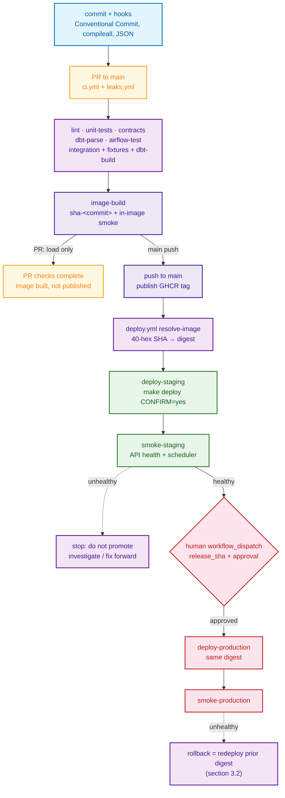
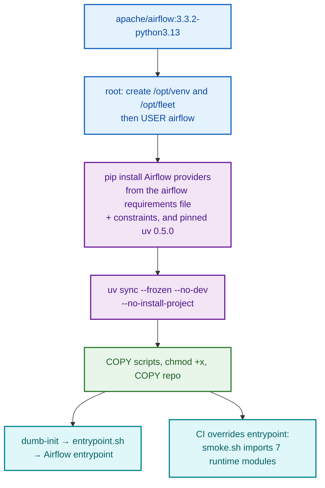
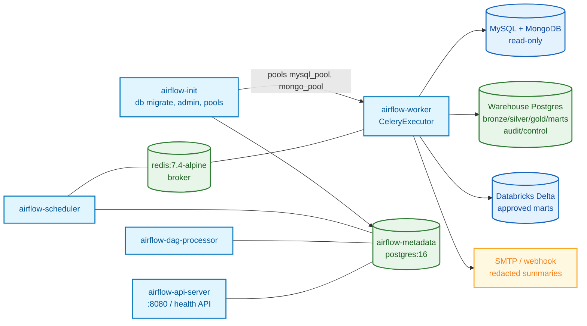
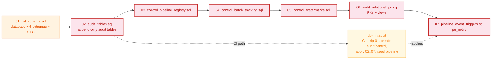

# Deployment — fleet dbt warehouse

**Purpose:** Define the authoritative build, promotion, runtime, rollback and recovery model for the warehouse.

**Audience:** Engineers and operators installing, deploying, or recovering the pipeline.

[Root README](README.md)

`ARCHITECTURE.md` explains the design and layer ownership; this document is the operational blueprint.

> **Reading guide.** Operators start at sections 3–4 (release, rollback, schema changes, backup, failure handling). Sections 5 onward are reference material on how the pipeline, image and runtime are built.
>
> **TODO markers.** Anything marked **TODO** needs a repo change or a decision. Remove the marker (and the matching entry in section 14) when it is done.

---

## 1. Delivery model in one paragraph

Every commit to `main` goes through GitHub Actions (lint, tests, contracts, dbt parse, Airflow DAG tests, fixture-backed dbt build, image build and in-image smoke). On a `main` push only, the image is published to GHCR as `sha-<40-hex-commit>`. `deploy.yml` resolves that tag to a digest, deploys **staging automatically**, runs smoke checks, and waits for a human `workflow_dispatch` plus `production` environment approval before deploying **production by the same digest**. Nothing is deployed by `latest`, and no workflow transforms data — the running image launches Airflow, which executes the repository scripts.

---

## 2. Environments

| Environment | Where | Warehouse / database | dbt target and schema | Trigger | Approval |
|---|---|---|---|---|---|
| Local dev | Developer machine, `make airflow-up` | `PG_DBNAME` from `.env` (default `fleet_dev`) | `dev`; custom schemas resolve verbatim (`silver`, `gold`, `marts`) | Manual `make` targets | `CONFIRM=yes` for destructive/prod actions |
| CI | `ubuntu-latest` GitHub runner + service `postgres:16` | `fleet_dev` | `ci`; `DBT_SCHEMA_PREFIX=ci_pr_<PR-or-run>_` | PR and push to `main` | Automatic; guarded by fixture and DB-name checks |
| Staging | Remote host, Compose project `fleet-airflow` | **TODO:** database name | **TODO:** `DBT_TARGET` value (e.g. `prod`) and schema prefix | CI success on `main` via `workflow_run` | Automatic, then smoke |
| Production | Separate remote host, same Compose project | **TODO:** database name | **TODO:** `DBT_TARGET` value (e.g. `prod`) and schema prefix | Manual `workflow_dispatch` with `release_sha` | `production` GitHub environment reviewers + smoke |

`ENV` in the Makefile means *dbt target* (`dev|ci|prod`), not a deployment environment. Production script commands need `ENV=prod CONFIRM=yes`. Deploy targets need `CONFIRM=yes` locally; the workflow supplies it.

Staging and production are configured only by the `.env` on each host and the GitHub environment secrets (section 8). The image is identical in both.

---

## 3. Release and rollback

### 3.1 Production release

1. Confirm CI and Gitleaks are green on the intended commit.
2. Confirm that exact SHA already ran on staging: the `deploy.yml` run for that SHA shows `deploy-staging` and `smoke-staging` succeeded. Do not promote a SHA that never passed staging. **TODO:** the workflow does not enforce this today; add a check in `resolve-image` for production dispatches.
3. Review the diff for things that need action *before* deploy:
   - changes to the SQL bootstrap scripts (`02`–`07`) → follow 3.3;
   - a changed `AIRFLOW_VERSION` → take a metadata backup first (3.4) and read the Airflow rollback note in 3.2;
   - new required environment variables → add them to the host `.env` first;
   - a dbt full refresh → needs `CONFIRM=yes` and a planned window.
4. Make sure no batch is mid-flight: `control.batch` has no `RUNNING` row, or pause `fleet_daily_load`. Recreating containers kills running worker tasks.
5. Record the currently running image so you have a rollback target:
   ```bash
   docker compose --env-file .env -f airflow/compose.yml ps --format '{{.Service}} {{.Image}}'
   ```
   Also note the last green production `deploy.yml` run and its `release_sha`.
6. Run `workflow_dispatch` on `deploy.yml` with the exact 40-character `release_sha`.
7. Approve the `production` environment; `resolve-image` pins the digest, then deploy and smoke run automatically.
8. Run the verification checklist (3.6). Unpause `fleet_daily_load` if you paused it.
9. If anything is unhealthy, roll back (3.2). Do not rebuild or use `latest`.

### 3.2 Rollback

**Image rollback** redeploys a previously built digest. There is no tag mutation and no rebuild.

| Environment | How |
|---|---|
| Production | `workflow_dispatch` on `deploy.yml` with `release_sha=<previous known-good sha>`, then approve. |
| Staging | **TODO:** `deploy-staging` only runs from `workflow_run`, so there is no dispatch path. Interim: run `make deploy CONFIRM=yes` locally with the `SSH_PRIVATE_KEY`, `DEPLOY_HOST`, `DEPLOY_USER`, `DEPLOY_PATH` and `IMAGE_REF=ghcr.io/<owner>/<repo>@sha256:<old digest>` variables set. Proper fix: allow `workflow_dispatch` on `deploy-staging`. |

Prerequisites: the old image must still exist in GHCR. **TODO:** define a retention policy that keeps at least the last N production digests, and keep a short release log (date, `release_sha`, digest, who approved).

**What an image rollback does not undo.** Redeploying old code does not rewind state:

| State | Reverted by image rollback? | Recovery |
|---|---|---|
| Containers, DAGs, scripts, dbt project (all in the image) | Yes | Redeploy the previous digest. |
| Airflow metadata DB (run history, pools, connections, schema) | No | Forward migrations are not reversed. If the bad release changed `AIRFLOW_VERSION`, the old image may refuse the migrated DB: restore the pre-deploy metadata backup or run `airflow db downgrade`. |
| Warehouse layers (`bronze`/`silver`/`gold`/`marts`) | No | Re-run the affected layers with the known-good image. Check `docs/DBT.md` before a full refresh; it needs `CONFIRM=yes`. If data is corrupted beyond a re-run, restore from backup (3.4). |
| `audit` / `control` schemas | No | Apply a compensating SQL script (3.3) or restore from backup. |
| Databricks marts | No | Republish with `make publish-marts`, or restore the Delta table to an earlier version (`RESTORE TABLE ... TO VERSION AS OF`) while version retention still allows it. |
| MySQL / MongoDB sources | Not applicable | Read-only; never modified. |

### 3.3 Schema changes (`audit` / `control` SQL scripts)

`make db-init` is a **bootstrap**: it creates a database from scratch. It is not a migration runner, and nothing applies edits of `02`–`07` to an already-running staging or production database. **TODO:** confirm which of `02`–`07` are idempotent, and consider adopting a migration tool (Sqitch, Flyway, Alembic) so this stops being a manual step.

Interim procedure for any change that must reach an existing database:

1. Write the change as a forward-only script using `IF NOT EXISTS` / `CREATE OR REPLACE` where possible, and keep the bootstrap scripts in sync so a fresh database ends in the same state.
2. Prove both paths: a fresh database through `make CONFIRM=yes db-init-audit`, and the new script applied on top of a restored copy of the latest backup.
3. Take a backup (3.4) and make sure no batch is running.
4. Apply to staging, then verify:
   ```bash
   psql -v ON_ERROR_STOP=1 -h "$PG_HOST" -p "$PG_PORT" -U "$PG_USER" -d "$PG_DBNAME" -f <script>.sql
   ```
5. Apply to production the same way.
6. Order relative to the image deploy: apply **additive** changes (new columns, tables, functions) *before* deploying the new image; apply **destructive** changes (drops, renames) *after* the old image is gone.

### 3.4 Backup and restore

**TODO:** fill in schedule, retention and storage location. This section lists what must be covered.

| What | Why | Method |
|---|---|---|
| Warehouse Postgres (all schemas incl. `audit`, `control`) | Primary state; `control.watermarks` drives incremental ingestion | `pg_dump -Fc` or the managed-database snapshot |
| Airflow metadata Postgres (`airflow-metadata` volume) | Run history, pools, connections, variables | `pg_dump -Fc` inside the `airflow-metadata` container |
| `.env` per host, especially `AIRFLOW__CORE__FERNET_KEY` | Without the Fernet key, stored connections and variables cannot be decrypted | Store in a secret manager, not only on the host |
| Databricks mart tables | Published output | Delta table history; confirm retention |

Warehouse dump (run from any machine that can reach it; credentials come from the environment):

```bash
PGPASSWORD="$PG_PASSWORD" pg_dump -h "$PG_HOST" -p "$PG_PORT" -U "$PG_USER" \
  -d "$PG_DBNAME" -Fc -f "fleet_warehouse_$(date -u +%Y%m%dT%H%M%SZ).dump"
```

Metadata dump (on the host, from `DEPLOY_PATH`; use the metadata DB user and name from your compose `.env`):

```bash
docker compose --env-file .env -f airflow/compose.yml exec -T airflow-metadata \
  pg_dump -U <metadata_user> -Fc <metadata_db> > airflow_metadata_$(date -u +%Y%m%dT%H%M%SZ).dump
```

Restore into a **scratch database first** and verify before touching production:

```bash
PGPASSWORD="$PG_PASSWORD" pg_restore -h "$PG_HOST" -p "$PG_PORT" -U "$PG_USER" \
  -d <scratch_db> --clean --if-exists <file>.dump
```

Take a backup before any release that changes schema, bumps `AIRFLOW_VERSION`, or runs a full refresh. **TODO:** test a restore at least once and record the result and time taken here.

### 3.5 Failure handling

- Retry only transient connection failures; never retry a contract or dbt data-test failure.
- Failed tasks write `audit.error_log` through SQL triggers; failed batches emit `pg_notify('pipeline_failure', …)`.
- Airflow failure templates instruct operators to clear the failed task so the same `control.batch` and run id are reused.
- `fleet_batch_cleanup` runs every 15 minutes and calls `control.fail_stale_batches()` only when `FLEET_STALE_CLEANUP_ENABLED=true` (default `false`); `FLEET_STALE_BATCH_MAX_AGE_HOURS` defaults to 6. Call the function manually if a batch is stuck, then investigate the root cause.

### 3.6 Verification checklist after a deploy

- `airflow-api-server` health endpoint returns success; `airflow-scheduler` job check passes.
- Every service runs the expected digest, so the host has not drifted:
  ```bash
  docker compose --env-file .env -f airflow/compose.yml ps --format '{{.Service}} {{.Image}}'
  ```
  Each Airflow service should show the `@sha256:` digest from the release.
- `fleet_daily_load` is unpaused and the next run is visible in the UI.
- `control.batch` has one `RUNNING` row at most; latest batch id matches the Airflow run id.
- `audit.v_batch_summary` shows the expected ingest tasks, dbt invocation and publish reconciliation.
- Five Databricks mart tables exist with expected schemas and non-zero row counts; driver scorecard is absent.
- Notifications (SMTP/webhook) deliver a redacted summary.

---

## 4. Local and operational runbooks

### 4.1 First-time local setup

```bash
cp .env.example .env          # fill real values; never commit .env
make install                  # uv sync --frozen
make env-check
make check-tools
make db-init CONFIRM=yes      # schemas, control/audit functions, triggers
make contracts-check
make dbt-deps
make lint-fast
make py-test
```

Start Airflow with `make airflow-up`; use `make airflow-down` to stop. Open `http://localhost:8080` (or `AIRFLOW_BASE_URL`), confirm connections, then unpause `fleet_daily_load`. `make help` is the authoritative target list.

### 4.2 Manual daily run (without Airflow)

```bash
make ingest ENV=dev
make dbt-silver ENV=dev && make dbt-silver-tests ENV=dev
make dbt-gold ENV=dev && make dbt-gold-tests ENV=dev
make dbt-marts ENV=dev && make dbt-marts-tests ENV=dev
make publish-marts ENV=dev
```

All dbt targets call `scripts/run_dbt.py`, which records the invocation and dbt artifacts in `audit.*`. Use a throwaway `PG_DBNAME` for local dbt experiments: outside CI, `generate_schema_name` uses `silver`, `gold` and `marts` verbatim.

### 4.3 CI-equivalent fixture build

```bash
make CONFIRM=yes db-init-audit
make PG_DBNAME=fleet_dev FIXTURE_LOAD=1 load-fixtures ENV=ci
make dbt-parse ENV=ci && make dbt-asset-keys-check
make dbt-build ENV=ci
```

`make py-cov COV_MIN=80` enforces the coverage gate before release; `make py-cov-report` reports coverage without failing. Run `make pipeline-stats ENV=dev` for read-only median/p95 run time and the largest loaded table from `audit.*` and `sql/metadata/09_list_table_sizes.sql`.

---

## 5. Build and promotion pipeline



### 5.1 `ci.yml`

| Item | Value |
|---|---|
| Triggers | `pull_request` to `main`, `push` to `main`. |
| Permissions | Top level `contents: read`; `image-build` and `stream-image-build` add `packages: write`. |
| Concurrency | `ci-<workflow>-<ref>`, cancels in-progress runs. |
| Python | `setup-uv` with Python 3.12 and cache; `make install` runs `uv sync --frozen`. **TODO:** the image runs Python 3.13, so tests and production use different interpreters. Align both (see section 14). |
| Jobs | `lint` (10m), `unit-tests` (10m), `contracts` (10m), `dbt-parse` (10m), `airflow-test` (10m), `stream-tests` (15m), `integration` (25m), `image-build` (35m), `stream-image-build` (35m). |
| Coverage | `unit-tests` runs `make py-cov COV_MIN=80` after `make py-unit`; measured TOTAL is 84.36% on `scripts` and `utils`. |
| dbt assets | `dbt-parse` runs `make dbt-parse ENV=ci` followed by `make dbt-asset-keys-check` against `airflow/assets/dbt_asset_keys.json`. |
| Integration | Service `postgres:16`, `make py-integration`, `make CONFIRM=yes db-init-audit`, `make dbt-deps`, `make load-fixtures ENV=ci`, `make dbt-build ENV=ci` (dbt unit tests are no longer excluded). |
| Stream tests | `make install` then `make stream-test` in an isolated `uv` environment with the locked `kafka` and `spark` groups; no broker is started. |
| Image | Builds `airflow/Dockerfile` from repo root with `AIRFLOW_VERSION=3.3.2`, `PYTHON_VERSION=3.13`, `GIT_SHA`. |
| Stream image | Builds `kafka/Dockerfile` from repo root with Python 3.12 and `GIT_SHA`, tags `sha-<commit>-stream`, reusing the commit SHA but not the Airflow tag. |
| Registry | Login and push only when `github.event_name == 'push'`; PR builds are load-only. |
| Smoke | `docker run --rm --entrypoint /opt/fleet/airflow/scripts/smoke.sh` with all runtime env forwarded; the stream image imports `fleet_stream` and `pyspark`. |
| Actions | Every third-party action is pinned by commit SHA; no `pull_request_target`. |

Fixture loading is double-guarded: `FIXTURE_LOAD=1` and `PG_DBNAME` must be `fleet_dev` or `fleet_it_*`. CI sets `DBT_SCHEMA_PREFIX=ci_pr_<n>_`, so dbt layer schemas are prefixed and never collide with production.

### 5.2 `deploy.yml`

| Job | Trigger | Environment | Key inputs | Command |
|---|---|---|---|---|
| `resolve-image` | `workflow_run` CI success on `main`, or `workflow_dispatch` | — | `release_sha` (dispatch) or `workflow_run.head_sha`; must be exactly 40 lowercase hex chars | `docker buildx imagetools inspect` on `sha-<sha>` and `sha-<sha>-stream` → digests, with `docker pull` fallback |
| `deploy-staging` | `workflow_run` only | `staging` | `STAGING_SSH_KEY`, `STAGING_DEPLOY_HOST`, `STAGING_DEPLOY_USER`, `STAGING_DEPLOY_PATH` | `make deploy CONFIRM=yes` |
| `smoke-staging` | after staging deploy | `staging` | same `STAGING_*` secrets | `make deploy-smoke` |
| `deploy-production` | `workflow_dispatch` only | `production` | `PRODUCTION_*` secrets | `make deploy CONFIRM=yes` |
| `smoke-production` | after production deploy | `production` | same `PRODUCTION_*` secrets | `make deploy-smoke` |

Deployments use `IMAGE_REF` as `ghcr.io/<owner>/<repo>@sha256:<digest>` and `STREAM_IMAGE_REF` as `ghcr.io/<owner>/<repo>@sha256:<stream-digest>`; the `latest` tag is never used or assumed.

### 5.3 `leaks.yml`

Triggers on every PR, push to `main`, Mondays 03:00 UTC and manual dispatch. One 15-minute job checks out full history, installs gitleaks 8.30.1 with checksum verification, and runs `gitleaks git --redact -v --config .gitleaks.toml .`. Placeholders in `.env.example`, `ci.yml` and docs are allowlisted; real secrets are not.

---

## 6. The container image



- One Dockerfile: `airflow/Dockerfile`. There is no root Dockerfile.
- `uv.lock` is authoritative in the image; dev dependencies are excluded.
- OCI labels carry the image title and `GIT_SHA` revision.
- `.dockerignore` excludes `.env`, caches, `dbt/target`, `dbt/dbt_packages`, logs, docs and Markdown. **TODO:** it does not exclude `.vscode`; add it (section 14).
- Runtime scripts live at `/opt/fleet/airflow/scripts`: `entrypoint.sh`, `init.sh`, `smoke.sh`, `healthcheck_worker.sh`.

---

## 7. Runtime topology



Compose project `fleet-airflow` defines `airflow-init`, `airflow-api-server` (`${AIRFLOW_PORT:-8080}:8080`), `airflow-scheduler`, `airflow-dag-processor`, `airflow-worker`, `airflow-metadata` and `redis`. Healthchecks gate startup; all runtime services depend on metadata and Redis being healthy and on `airflow-init` completing successfully. DAGs are paused at creation; the operator unpauses `fleet_daily_load` after verifying connections and pools.

`init.sh` requires `AIRFLOW__CORE__FERNET_KEY` and admin credentials, runs `airflow db migrate`, creates the admin user and sets `mysql_pool`/`mongo_pool` from `MYSQL_POOL_SLOTS`/`MONGO_POOL_SLOTS`.

---

## 8. Database bootstrap



`make db-init CONFIRM=yes` applies `01` against the `postgres` database and `02..07` against `DB_NAME`, with `ON_ERROR_STOP=1`. The order matters: `06` adds FKs to tables created by `02`–`05`, and `07` adds trigger logic that depends on both.

CI uses `make CONFIRM=yes db-init-audit` instead: it creates only `audit` and `control`, applies `02..07`, and seeds the `fleet_daily`/`fleet_daily_load` registry row with cron `0 2 * * *`. This avoids the hard-coded database name in `01_init_schema.sql`.

This is bootstrap only. For changes to an existing database, see 3.3.

---

## 9. Configuration and secrets

All configuration is environment-based; `.env` is ignored, `.env.example` holds placeholders only.

| Group | Representative variables | Consumed by |
|---|---|---|
| Warehouse | `PG_HOST`, `PG_PORT`, `PG_USER`, `PG_PASSWORD`, `PG_DBNAME` | Python connections, dbt profiles, `psql` bootstrap via `DB_USER`/`DB_NAME`/`PG_HOST`/`PG_PORT`/`PG_PASSWORD` |
| Sources | `MYSQL_HOST/PORT/USER/PASSWORD/DATABASE`, `MYSQL_SSL_MODE`, `MONGO_URI`, `MONGO_DB_NAME` | `utils/connection.py`, ingestion, Airflow preflight |
| Databricks | `DATABRICKS_HOST`, `DATABRICKS_HTTP_PATH`, `DATABRICKS_TOKEN`, `DATABRICKS_CATALOG`, `DATABRICKS_SCHEMA` | Publish job and preflight; `DATABRICKS_SCHEMA` is mandatory |
| dbt | `DBT_TARGET`, `DBT_SCHEMA_PREFIX`, `DBT_DEV_SCHEMA`, `DBT_SELECT`, `EXCLUDE` | Airflow command builders, `profiles.yml`, Makefile |
| Airflow | `AIRFLOW__CORE__FERNET_KEY`, `AIRFLOW__API__BASE_URL`, `AIRFLOW_DB_PASSWORD`, `AIRFLOW_ADMIN_USERNAME/PASSWORD/EMAIL`, `AIRFLOW_UID`, `AIRFLOW_PORT`, `AIRFLOW_IMAGE` | Compose, `init.sh` |
| Alerting | `SMTP_*`, `ALERT_WEBHOOK_URL`, `ALERT_*` | Airflow notification helpers |
| Fixture / tuning | `FIXTURE_LOAD`, `PUBLISH_*`, `DATABRICKS_MAX_ATTEMPTS`, pool slots | Fixture loader, publisher, Airflow pools |
| Stale cleanup | `FLEET_STALE_CLEANUP_ENABLED` (default `false`), `FLEET_STALE_BATCH_MAX_AGE_HOURS` (default `6`) | `fleet_batch_cleanup` calls `control.fail_stale_batches` only when enabled |
| Coverage / stats | `COV_MIN` (default `80`), `COV_REPORT`, `PIPELINE`, `PIPELINE_STATS_DAYS`, `PIPELINE_STATS_LIMIT`, `PIPELINE_STATS_FORMAT` | `make py-cov`, `make py-cov-report`, `make pipeline-stats` |

GitHub secrets by environment:

| Secret set | Used by | Purpose |
|---|---|---|
| `GITHUB_TOKEN` (automatic) | `ci.yml`, `deploy.yml` | GHCR login only; least-privilege scopes. |
| `STAGING_SSH_KEY`, `STAGING_DEPLOY_HOST`, `STAGING_DEPLOY_USER`, `STAGING_DEPLOY_PATH` | `deploy-staging`, `smoke-staging` | SSH into staging host. |
| `PRODUCTION_SSH_KEY`, `PRODUCTION_DEPLOY_HOST`, `PRODUCTION_DEPLOY_USER`, `PRODUCTION_DEPLOY_PATH` | `deploy-production`, `smoke-production` | SSH into production host. |
| `.env` on each host | Compose | Runtime credentials; never stored in the image or repository. |

`utils/engine.py` fails fast on missing required connection variables; `make env-check` exercises that import. Airflow preflight reports only variable *names*, never values.

---

## 10. Remote deploy mechanics

`make deploy CONFIRM=yes` → `bash scripts/deploy.sh deploy`; `make deploy-smoke` → `bash scripts/deploy.sh smoke`.

| Step | Behaviour |
|---|---|
| Validate | Mode must be `deploy` or `smoke`; require `SSH_PRIVATE_KEY`, `DEPLOY_HOST`, `DEPLOY_USER`, `DEPLOY_PATH` and, for deploy, `IMAGE_REF`. |
| Key handling | `umask 077`, key written to a `mktemp` file, `chmod 600`, trap removes it; SSH uses `BatchMode=yes` and a 15s connect timeout. |
| Deploy | Remote `export AIRFLOW_IMAGE=$IMAGE_REF` and `STREAM_IMAGE=$STREAM_IMAGE_REF`, `cd $DEPLOY_PATH`, `docker compose --env-file .env -f airflow/compose.yml pull`, then `up -d --no-build --remove-orphans`, then `ps`. |
| Smoke | `docker compose ps`; `curl --fail` against `http://localhost:8080/api/v2/monitor/health` inside `airflow-api-server`; `airflow jobs check --job-type SchedulerJob` inside `airflow-scheduler`. |
| Rollback | See 3.2. |

**Host drift.** `AIRFLOW_IMAGE` is exported for the deploy session only; it is not persisted on the host. A later manual `docker compose up` on that host falls back to whatever `AIRFLOW_IMAGE` is in `.env` and can silently change the running version. Rules until this is fixed:

- Never run `docker compose up` by hand on staging or production; deploy through `make deploy` / the workflow.
- Check the running digest after every deploy (3.6).
- **TODO:** persist the deployed digest on the host (for example, write it to a host-side env file that compose reads) so restarts keep the same image.

The local `CONFIRM=yes` guard is in the Makefile, not in `deploy.sh`; keep deploy access restricted through the GitHub environments and host SSH policy.

---

## 11. Security and network

What is already in place:

- No credentials in the image or repository; runtime secrets live in the host `.env`, and Airflow preflight prints variable names only.
- Source systems are accessed read-only; alerts carry redacted summaries.
- `GITHUB_TOKEN` is least-privilege; all third-party actions are pinned by SHA; gitleaks scans full history weekly and on every PR.
- Deploy SSH uses `BatchMode=yes` with a temp key file that is `chmod 600` and removed on exit.

To decide and document (**TODO**):

- **UI exposure.** The compose port mapping `${AIRFLOW_PORT:-8080}:8080` has no host IP, so Docker binds it on all interfaces. Bind to `127.0.0.1` and put a reverse proxy with TLS in front, or restrict access to a VPN or an allowed IP range.
- **Admin credentials.** Rotate the Airflow admin password after first setup, and state who holds production access.
- **Redis and metadata Postgres.** Confirm neither publishes a host port.
- **SSH host verification.** Confirm `deploy.sh` verifies the host key (pinned `known_hosts`) instead of disabling strict checking.
- **Secret rotation.** Define how and when `PRODUCTION_SSH_KEY`, database passwords, `DATABRICKS_TOKEN` and the Fernet key are rotated. Rotating the Fernet key needs its own procedure.

---

## 12. Guardrails

| Gate | Where | Effect |
|---|---|---|
| Conventional Commit + 72-char subject | `.githooks/commit-msg` | Blocks malformed commit messages. |
| `compileall` + contract JSON validation | `.githooks/pre-push` | Blocks broken Python or malformed contract JSON. |
| Optional pre-commit secret scan | `helpers/protect_env.sh --install` | Blocks `.env`, key files and secret-like staged diffs; not installed by default. |
| CI quality jobs | `.github/workflows/ci.yml` | Blocks merge on lint, test, coverage, contract, parse, asset-key, DAG or image smoke failure. |
| GitHub environments | `deploy.yml` | Staging automatic; production requires reviewers. |
| Makefile confirmations | `Makefile` | `ENV=prod`, destructive targets, full refresh and deploy need `CONFIRM=yes`. |
| Immutable image tag | `ci.yml`, `deploy.yml` | Deploy by `sha-<commit>` resolved to a digest; no `latest`. |
| Gitleaks | `.github/workflows/leaks.yml` | Full-history secret scan with placeholders allowlisted. |

---

## 13. Related documents

- `ARCHITECTURE.md` — system blueprint, data flow and ownership.
- `README.md` — repository map and quickstart.
- `airflow/README.md` — Airflow setup, DAG graph and operations.
- `docs/DBT.md` — dbt sources, macros, variables and commands.
- `docs/TESTING.md` — test inventory and known gaps.
- `AGENTS.md` — repository rules, permissions and definition of done.

---

## 14. Known gaps and required repo fixes

Fix these in the repo, then delete the entry and its TODO marker above. Ordered by priority.

| # | Item | Fix |
|---|---|---|
| 1 | **Python version skew:** CI tests on 3.12, image and production run 3.13. | Set `setup-uv` and `requires-python` to 3.13 (or build the image on 3.12). Re-lock `uv.lock`. |
| 2 | **No migration path** for `audit`/`control` changes on existing databases (3.3). | Verify idempotency of `02`–`07`; adopt a migration tool. |
| 3 | **Rollback does not cover data**; no GHCR retention policy or release log (3.2). | Decide retention, keep a release log, rehearse a data recovery. |
| 4 | **No backup/restore process** (3.4). | Schedule backups, store the Fernet key safely, test one restore. |
| 5 | **Production can deploy a SHA that never passed staging.** | Add a staging-success check to `resolve-image` for dispatches. |
| 6 | **No staging rollback path;** `deploy-staging` runs only on `workflow_run`. | Add `workflow_dispatch` to `deploy-staging`. |
| 7 | **Host drift:** `AIRFLOW_IMAGE` is not persisted (section 10). | Persist the digest on the host. |
| 8 | **UI exposed on all interfaces,** no documented TLS/auth/rotation (section 11). | Bind to localhost behind a proxy or VPN; document rotation. |
| 9 | `.dockerignore` does not exclude `.vscode`. | Add `.vscode/`. |
| 10 | `.devcontainer/devcontainer.json` references a missing root compose file, a non-existent `airflow-webserver` service and a non-existent `airflow/requirements.txt`. | Fix or delete it. Until then use `make airflow-up`. |
| 11 | The airflow requirements file is misspelled in the repo (`requirments-airflow.txt`). | Rename it and update `airflow/Dockerfile` and any references. |
| 12 | Staging/production `DBT_TARGET`, database names and schema prefixes are undocumented (section 2). | Fill in the environments table. |
| 13 | `make ci` is only a local alias for `verify` (lint + pytest); GitHub Actions is the real pipeline. | Rename the alias or document it in `make help`. |
| 14 | Snapshots exist for customers, drivers and trucks, but facts and marts still use current-state SCD1 dimensions; the weekly report DAG remains a skeleton. | Approve payload policy and implement `fleet_report_weekly`; wire SCD2 only as a separate dimension change. |
| 15 | Scheduling is still cron and task dependencies; manifest-keyed asset outlets publish lineage but do not trigger downstream DAGs. | Keep asset keys in sync with `make dbt-asset-keys-check`; treat event-driven scheduling as roadmap, not a deployment blocker. |
