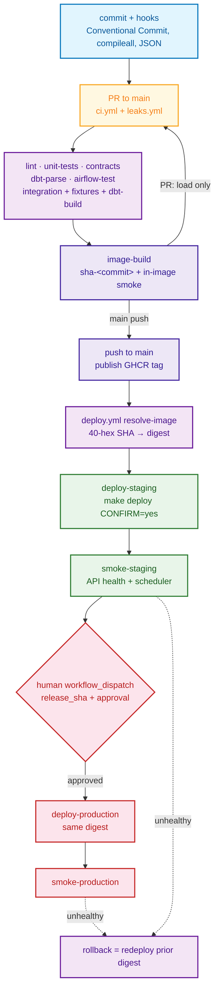
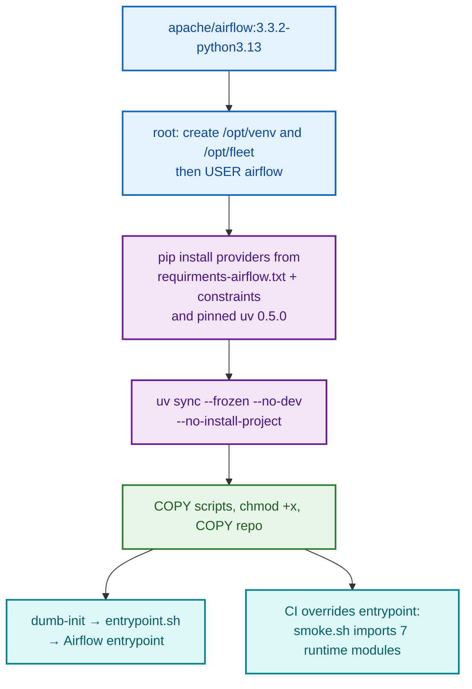
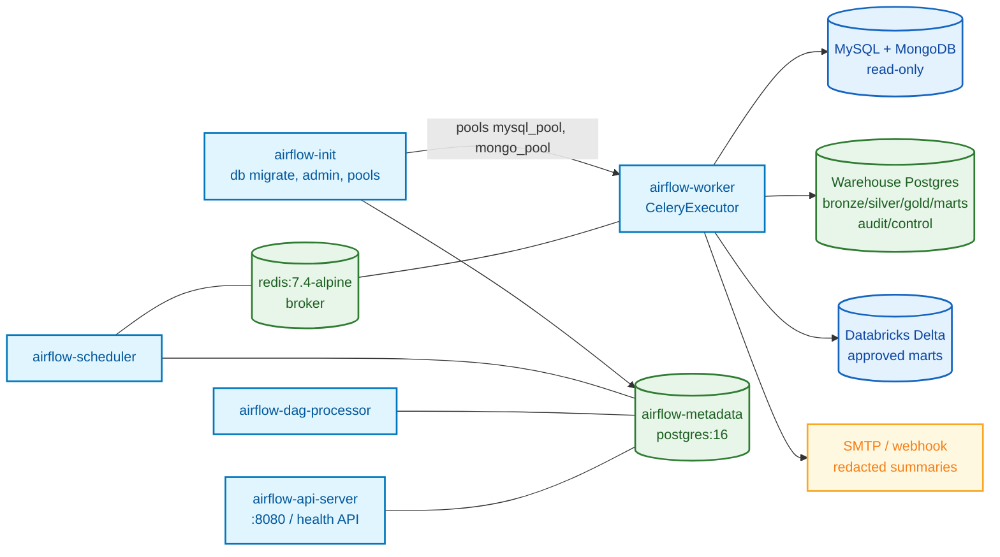
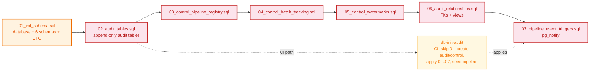

# Deployment — fleet dbt warehouse

**Purpose:** Define the authoritative build, promotion, runtime, and rollback model for the warehouse.

**Audience:** Engineers and operators installing, deploying, or recovering the pipeline.

[Root README](README.md)

How this project is built, shipped, promoted and run. `ARCHITECTURE.md` explains the design and layer ownership; this document is the operational blueprint.

---

## 1. Delivery model in one paragraph

Every commit to `main` goes through GitHub Actions (lint, tests, contracts, dbt parse, Airflow DAG tests, fixture-backed dbt build, image build and in-image smoke). On a `main` push only, the image is published to GHCR as `sha-<40-hex-commit>`. `deploy.yml` resolves that tag to a digest, deploys **staging automatically**, runs smoke checks, and waits for a human `workflow_dispatch` plus `production` environment approval before deploying **production by the same digest**. Nothing is deployed by `latest`, and no workflow transforms data — the running image launches Airflow, which executes the repository scripts.

---

## 2. Environments

| Environment | Where | Warehouse / database | dbt target and schema | Trigger | Approval |
|---|---|---|---|---|---|
| Local dev | Developer machine, `make airflow-up` | `PG_DBNAME` from `.env` (default `fleet_warehouse`) | `dev`; custom schemas resolve verbatim (`silver`, `gold`, `marts`) | Manual `make` targets | `CONFIRM=yes` for destructive/prod actions |
| CI | `ubuntu-latest` GitHub runner + service `postgres:16` | `fleet_dev` | `ci`; `DBT_SCHEMA_PREFIX=ci_pr_<PR-or-run>_` | PR and push to `main` | Automatic; guarded by fixture and DB-name checks |
| Staging | Remote host, Compose project `fleet-airflow` | Staging `.env` on host | Runtime `DBT_TARGET` from env | CI success on `main` via `workflow_run` | Automatic, then smoke |
| Production | Separate remote host, same Compose project | Production `.env` on host | Runtime `DBT_TARGET` from env | Manual `workflow_dispatch` with `release_sha` | `production` GitHub environment reviewers + smoke |

`ENV` in the Makefile means *dbt target* (`dev|ci|prod`), not a deployment environment. Production script commands need `ENV=prod CONFIRM=yes`. Deploy targets need `CONFIRM=yes` locally; the workflow supplies it.

---

## 3. Build and promotion pipeline



### 3.1 `ci.yml`

| Item | Value |
|---|---|
| Triggers | `pull_request` to `main`, `push` to `main`. |
| Permissions | Top level `contents: read`; `image-build` adds `packages: write`. |
| Concurrency | `ci-<workflow>-<ref>`, cancels in-progress runs. |
| Python | `setup-uv` with Python 3.12 and cache; `make install` runs `uv sync --frozen`. |
| Jobs | `lint` (10m), `unit-tests` (10m), `contracts` (10m), `dbt-parse` (10m), `airflow-test` (10m), `integration` (25m), `image-build` (35m). |
| Integration | Service `postgres:16`, `make py-integration`, `make CONFIRM=yes db-init-audit`, `make dbt-deps`, `make load-fixtures ENV=ci`, `make dbt-build ENV=ci EXCLUDE=unit_test`. |
| Image | Builds `airflow/Dockerfile` from repo root with `AIRFLOW_VERSION=3.3.2`, `PYTHON_VERSION=3.13`, `GIT_SHA`. |
| Registry | Login and push only when `github.event_name == 'push'`; PR builds are load-only. |
| Smoke | `docker run --rm --entrypoint /opt/fleet/airflow/scripts/smoke.sh` with all runtime env forwarded. |
| Actions | Every third-party action is pinned by commit SHA; no `pull_request_target`. |

Fixture loading is double-guarded: `FIXTURE_LOAD=1` and `PG_DBNAME` must be `fleet_dev` or `fleet_it_*`. CI sets `DBT_SCHEMA_PREFIX=ci_pr_<n>_`, so dbt layer schemas are prefixed and never collide with production.

### 3.2 `deploy.yml`

| Job | Trigger | Environment | Key inputs | Command |
|---|---|---|---|---|
| `resolve-image` | `workflow_run` CI success on `main`, or `workflow_dispatch` | — | `release_sha` (dispatch) or `workflow_run.head_sha`; must be exactly 40 lowercase hex chars | `docker buildx imagetools inspect ghcr.io/<repo>:sha-<sha>` → digest, with `docker pull` fallback |
| `deploy-staging` | `workflow_run` only | `staging` | `STAGING_SSH_KEY`, `STAGING_DEPLOY_HOST`, `STAGING_DEPLOY_USER`, `STAGING_DEPLOY_PATH` | `make deploy CONFIRM=yes` |
| `smoke-staging` | after staging deploy | `staging` | same `STAGING_*` secrets | `make deploy-smoke` |
| `deploy-production` | `workflow_dispatch` only | `production` | `PRODUCTION_*` secrets | `make deploy CONFIRM=yes` |
| `smoke-production` | after production deploy | `production` | same `PRODUCTION_*` secrets | `make deploy-smoke` |

Deployments use `IMAGE_REF` as `ghcr.io/<owner>/<repo>@sha256:<digest>`; the `latest` tag is never used or assumed.

### 3.3 `leaks.yml`

Triggers on every PR, push to `main`, Mondays 03:00 UTC and manual dispatch. One 15-minute job checks out full history, installs gitleaks 8.30.1 with checksum verification, and runs `gitleaks git --redact -v --config .gitleaks.toml .`. Placeholders in `.env.example`, `ci.yml` and docs are allowlisted; real secrets are not.

---

## 4. The container image



- One Dockerfile: `airflow/Dockerfile`. There is no root Dockerfile.
- `uv.lock` is authoritative in the image; dev dependencies are excluded.
- OCI labels carry the image title and `GIT_SHA` revision.
- `.dockerignore` excludes `.env`, caches, `dbt/target`, `dbt/dbt_packages`, logs, docs and Markdown. It does **not** currently exclude `.vscode`, so keep local editor secrets out of that directory.
- Runtime scripts live at `/opt/fleet/airflow/scripts`: `entrypoint.sh`, `init.sh`, `smoke.sh`, `healthcheck_worker.sh`.

---

## 5. Runtime topology



Compose project `fleet-airflow` defines `airflow-init`, `airflow-api-server` (`${AIRFLOW_PORT:-8080}:8080`), `airflow-scheduler`, `airflow-dag-processor`, `airflow-worker`, `airflow-metadata` and `redis`. Healthchecks gate startup; all runtime services depend on metadata and Redis being healthy and on `airflow-init` completing successfully. DAGs are paused at creation; the operator unpauses `fleet_daily_load` after verifying connections and pools.

`init.sh` requires `AIRFLOW__CORE__FERNET_KEY` and admin credentials, runs `airflow db migrate`, creates the admin user and sets `mysql_pool`/`mongo_pool` from `MYSQL_POOL_SLOTS`/`MONGO_POOL_SLOTS`.

---

## 6. Database bootstrap



`make db-init CONFIRM=yes` applies `01` against the `postgres` database and `02..07` against `DB_NAME`, with `ON_ERROR_STOP=1`. The order matters: `06` adds FKs to tables created by `02`–`05`, and `07` adds trigger logic that depends on both.

CI uses `make CONFIRM=yes db-init-audit` instead: it creates only `audit` and `control`, applies `02..07`, and seeds the `fleet_daily`/`fleet_daily_load` registry row with cron `0 2 * * *`. This avoids the hard-coded database name in `01_init_schema.sql`.

---

## 7. Configuration and secrets

All configuration is environment-based; `.env` is ignored, `.env.example` holds placeholders only.

| Group | Representative variables | Consumed by |
|---|---|---|
| Warehouse | `PG_HOST`, `PG_PORT`, `PG_USER`, `PG_PASSWORD`, `PG_DBNAME` | Python connections, dbt profiles, `psql` bootstrap via `DB_USER`/`DB_NAME`/`PG_HOST`/`PG_PORT`/`PG_PASSWORD` |
| Sources | `MYSQL_HOST/PORT/USER/PASSWORD/DATABASE`, `MYSQL_SSL_MODE`, `MONGO_URI`, `MONGO_DB_NAME` | `utils/connection.py`, ingestion, Airflow preflight |
| Databricks | `DATABRICKS_HOST`, `DATABRICKS_HTTP_PATH`, `DATABRICKS_TOKEN`, `DATABRICKS_CATALOG`, `DATABRICKS_SCHEMA` | Publish job and preflight; `DATABRICKS_SCHEMA` is mandatory |
| dbt | `DBT_TARGET`, `DBT_SCHEMA_PREFIX`, `DBT_DEV_SCHEMA`, `DBT_SELECT`, `EXCLUDE` | Airflow command builders, `profiles.yml`, Makefile |
| Airflow | `AIRFLOW__CORE__FERNET_KEY`, `AIRFLOW__API__BASE_URL`, `AIRFLOW_DB_PASSWORD`, `AIRFLOW_ADMIN_USERNAME/PASSWORD/EMAIL`, `AIRFLOW_UID`, `AIRFLOW_PORT`, `AIRFLOW_IMAGE` | Compose, `init.sh` |
| Alerting | `SMTP_*`, `ALERT_WEBHOOK_URL`, `ALERT_*` | Airflow notification helpers |
| Fixture / tuning | `FIXTURE_LOAD`, `PUBLISH_*`, `DATABRICKS_MAX_ATTEMPTS`, pool slots | Fixture loader, publisher, Airflow pools |

GitHub secrets by environment:

| Secret set | Used by | Purpose |
|---|---|---|
| `GITHUB_TOKEN` (automatic) | `ci.yml`, `deploy.yml` | GHCR login only; least-privilege scopes. |
| `STAGING_SSH_KEY`, `STAGING_DEPLOY_HOST`, `STAGING_DEPLOY_USER`, `STAGING_DEPLOY_PATH` | `deploy-staging`, `smoke-staging` | SSH into staging host. |
| `PRODUCTION_SSH_KEY`, `PRODUCTION_DEPLOY_HOST`, `PRODUCTION_DEPLOY_USER`, `PRODUCTION_DEPLOY_PATH` | `deploy-production`, `smoke-production` | SSH into production host. |
| `.env` on each host | Compose | Runtime credentials; never stored in the image or repository. |

`utils/engine.py` fails fast on missing required connection variables; `make env-check` exercises that import. Airflow preflight reports only variable *names*, never values.

---

## 8. Remote deploy mechanics

`make deploy CONFIRM=yes` → `bash scripts/deploy.sh deploy`; `make deploy-smoke` → `bash scripts/deploy.sh smoke`.

| Step | Behaviour |
|---|---|
| Validate | Mode must be `deploy` or `smoke`; require `SSH_PRIVATE_KEY`, `DEPLOY_HOST`, `DEPLOY_USER`, `DEPLOY_PATH` and, for deploy, `IMAGE_REF`. |
| Key handling | `umask 077`, key written to a `mktemp` file, `chmod 600`, trap removes it; SSH uses `BatchMode=yes` and a 15s connect timeout. |
| Deploy | Remote `export AIRFLOW_IMAGE=$IMAGE_REF`, `cd $DEPLOY_PATH`, `docker compose --env-file .env -f airflow/compose.yml pull`, then `up -d --no-build --remove-orphans`, then `ps`. |
| Smoke | `docker compose ps`; `curl --fail` against `http://localhost:8080/api/v2/monitor/health` inside `airflow-api-server`; `airflow jobs check --job-type SchedulerJob` inside `airflow-scheduler`. |
| Rollback | Redeploy a previously built digest with `workflow_dispatch release_sha=<old sha>`; no tag mutation and no rebuild. |

The local `CONFIRM=yes` guard is in the Makefile, not in `deploy.sh`; keep deploy access restricted through the GitHub environments and host SSH policy.

---

## 9. Local and operational runbooks

### 9.1 First-time local setup

```bash
cp .env.example .env          # fill real values; never commit .env
make install                  # uv sync --frozen
make env-check
make check-tools
make db-init CONFIRM=yes      # schemas, control/audit functions, triggers
make contracts-check
make dbt-deps
make lint-fast
make py-test
```

Start Airflow with `make airflow-up`; use `make airflow-down` to stop. Open `http://localhost:8080` (or `AIRFLOW_BASE_URL`), confirm connections, then unpause `fleet_daily_load`. `make help` is the authoritative target list.

### 9.2 Manual daily run (without Airflow)

```bash
make ingest ENV=dev
make dbt-silver ENV=dev && make dbt-silver-tests ENV=dev
make dbt-gold ENV=dev && make dbt-gold-tests ENV=dev
make dbt-marts ENV=dev && make dbt-marts-tests ENV=dev
make publish-marts ENV=dev
```

All dbt targets call `scripts/run_dbt.py`, which records the invocation and dbt artifacts in `audit.*`. Use a throwaway `PG_DBNAME` for local dbt experiments: outside CI, `generate_schema_name` uses `silver`, `gold` and `marts` verbatim.

### 9.3 CI-equivalent fixture build

```bash
make CONFIRM=yes db-init-audit
make PG_DBNAME=fleet_dev FIXTURE_LOAD=1 load-fixtures ENV=ci
make dbt-build ENV=ci EXCLUDE=unit_test
```

### 9.4 Production release

1. Confirm CI and Gitleaks are green on the intended commit.
2. Run `workflow_dispatch` on `deploy.yml` with the exact 40-character `release_sha`.
3. Approve the `production` environment; `resolve-image` pins the digest, then deploy and smoke run automatically.
4. Verify `control.batch`, `audit.v_batch_summary`, Airflow scheduler health and mart row counts.
5. If unhealthy, redeploy the last known-good digest; do not rebuild or use `latest`.

### 9.5 Failure handling

- Retry only transient connection failures; never retry a contract or dbt data-test failure.
- Failed tasks write `audit.error_log` through SQL triggers; failed batches emit `pg_notify('pipeline_failure', …)`.
- Airflow failure templates instruct operators to clear the failed task so the same `control.batch` and run id are reused.
- `control.fail_stale_batches()` exists but is not scheduled; call it manually if a batch is stuck, then investigate the root cause.

---

## 10. Guardrails

| Gate | Where | Effect |
|---|---|---|
| Conventional Commit + 72-char subject | `.githooks/commit-msg` | Blocks malformed commit messages. |
| `compileall` + contract JSON validation | `.githooks/pre-push` | Blocks broken Python or malformed contract JSON. |
| Optional pre-commit secret scan | `helpers/protect_env.sh --install` | Blocks `.env`, key files and secret-like staged diffs; not installed by default. |
| CI quality jobs | `.github/workflows/ci.yml` | Blocks merge on lint, test, contract, parse, DAG or image smoke failure. |
| GitHub environments | `deploy.yml` | Staging automatic; production requires reviewers. |
| Makefile confirmations | `Makefile` | `ENV=prod`, destructive targets, full refresh and deploy need `CONFIRM=yes`. |
| Immutable image tag | `ci.yml`, `deploy.yml` | Deploy by `sha-<commit>` resolved to a digest; no `latest`. |
| Gitleaks | `.github/workflows/leaks.yml` | Full-history secret scan with placeholders allowlisted. |

---

## 11. Verification checklist after a deploy

- `airflow-api-server` health endpoint returns success; `airflow-scheduler` job check passes.
- `fleet_daily_load` is unpaused and the next run is visible in the UI.
- `control.batch` has one `RUNNING` row at most; latest batch id matches the Airflow run id.
- `audit.v_batch_summary` shows the expected ingest tasks, dbt invocation and publish reconciliation.
- Five Databricks mart tables exist with expected schemas and non-zero row counts; driver scorecard is absent.
- Notifications (SMTP/webhook) deliver a redacted summary.

---

## 12. Current deployment gaps

- Only `ci.yml`, `deploy.yml` and `leaks.yml` exist. Referenced `nightly.yml`, `cleanup-ci.yml`, `release.yml`, Dependabot and `make smoke-ci` are not implemented.
- `make ci` is only a local alias for `verify` (lint + pytest); GitHub Actions is the real pipeline.
- No coverage gate is configured; no dbt unit tests or snapshots are committed yet.
- Airflow assets are not derived from the dbt manifest; scheduling is cron and task dependencies.
- `.devcontainer/devcontainer.json` references a missing root compose file, a non-existent `airflow-webserver` service and a non-existent `airflow/requirements.txt`; use `make airflow-up` instead.
- `asset keys`, stale-batch cleanup and weekly/watchdog DAG bodies remain future work.

---

## 13. Related documents

- `ARCHITECTURE.md` — system blueprint, data flow and ownership.
- `README.md` — repository map and quickstart.
- `airflow/README.md` — Airflow setup, DAG graph and operations.
- `docs/DBT.md` — dbt sources, macros, variables and commands.
- `docs/TESTING.md` — test inventory and known gaps.
- `AGENTS.md` — repository rules, permissions and definition of done.
