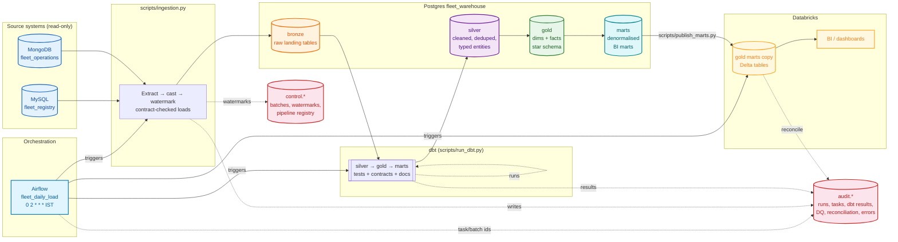
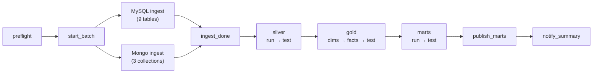

<p align="center">

  

</p>


<h1 align="center">Fleet DBT Warehouse</h1>


A daily analytics warehouse for logistics operations that uses watermark-based micro-batch processing to ingest data from MySQL `fleet_registry` and MongoDB `fleet_operations` into PostgreSQL `bronze`. dbt transforms the data through `silver`, `gold`, and `marts`, with approved non-PII marts published to Databricks for BI. Airflow orchestrates daily workflows, Makefile provides a unified entry point, Python handles data movement, and dbt owns all transformations.


## At a glance


| Concern | Choice |

|---|---|

| Source systems | MySQL `fleet_registry`, MongoDB `fleet_operations` |

| Landing | Postgres `bronze`, written only by `scripts/ingestion.py` |

| Transformation | dbt `silver` → `gold` → `marts` |

| Serving | Approved Postgres marts copied to Databricks by `scripts/publish_marts.py` |

| Orchestration | Airflow DAG `fleet_daily_load`, daily at `0 2 * * *` Asia/Kolkata |

| Entrypoint | `make` (`make help` lists every target) |

| Config | `.env` copied from `.env.example`; never commit real values |

| Contracts | `contracts/sources/*.yml`, checked by `make contracts-check` |

| Audit/control | Postgres `control.*` for state, `audit.*` for append-only evidence |


## Pipeline flow





### Layer colours


| Colour | Layer | Written by | Meaning |

|---|---|---|---|

| light blue | Orchestration | Airflow only | Schedules scripts; never moves or transforms data |

| 🟠 orange | `bronze` | `scripts/ingestion.py` only | Raw landing; immutable history of what arrived |

| 🟣 purple | `silver` | dbt only | One model per source table: dedupe, cast, validate |

| 🟢 green | `gold` | dbt only | Star schema: 7 SCD1 dims + `dim_date` + 6 facts |

| 🔵 teal | `marts` | dbt only | Denormalised, ratio-safe BI aggregates |

| 🔵 cyan | Databricks marts | `scripts/publish_marts.py` only | Synced copy of approved marts for BI |

| 🔴 pink | `control` / `audit` | Python + SQL functions | Run metadata, watermarks, evidence |


---


## Repository map


```text

├── AGENTS.md / CLAUDE.md      # agent rules and Claude-specific notes

├── CHANGELOG.md               # Keep a Changelog release history

├── Makefile                   # single entry point; run make help

├── pyproject.toml / uv.lock   # dependencies, pytest and Ruff config

├── .env.example               # every config knob, placeholders only

├── .githooks/                 # commit-msg and pre-push guards

│

├── contracts/                 # source-of-truth schemas for landing tables (12 YAML + samples)

├── scripts/                   # runnable pipeline steps

│   ├── ingestion.py           #   MySQL + MongoDB → bronze, watermarks, audit

│   ├── run_dbt.py             #   dbt runner + audit artifact loader

│   ├── publish_marts.py       #   approved Postgres marts → Databricks

│   └── run_notebooks.py       #   reproducible notebook runner

├── utils/                     # shared plumbing: config, connections, audit, logger

│

├── dbt/                       # transformation layer

│   ├── models/                #   bronze sources, silver (12), gold (13), marts (6)

│   ├── macros/                #   cleaning, incremental, gold and mart helpers

│   └── tests/generic/silver/  #   project-specific generic tests

│

├── sql/

│   ├── scripts/               #   bootstrap 01..07 applied by make db-init

│   └── metadata/              #   read-only inspection queries

│

├── airflow/                   # orchestration stack (Dockerfile, compose, README)

│   ├── dags/                  #   fleet_dbt_daliy, fleet_report_weekly, fleet_watchdog

│   ├── helpers/               #   preflight, callbacks, notify, templates

│   └── tests/                 #   DAG unit tests

│

├── docs/                      # DBT.md, FINDING.md, TESTING.md

├── tests/                     # unit / integration / smoke

├── helpers/                   # shell utilities (health, backup, logs, env protection)

└── notebooks/                 # EDA notebooks

```


Generated and not committed: `.env`, `.venv/`, `dbt/target/`, `dbt/logs/`,

`dbt/dbt_packages/`, `logs/`, `out/` and Python caches.


## Quickstart


For a step-by-step guide see [`docs/QUICKSTART.md`](docs/QUICKSTART.md).


```bash

cp .env.example .env            # fill real values; never commit .env

make install                    # create/update .venv from uv.lock

make env-check                  # verify required env vars

make db-init CONFIRM=yes        # bootstrap warehouse schemas/control/audit

make load-fixtures ENV=ci PG_DBNAME=fleet_dev  # optional: sample bronze data

make dbt-build ENV=dev          # silver -> gold -> marts

make report                     # build reports/img and reports/findings

```


## Common commands


```bash

# Quality / contracts

make lint-fast                  # Ruff lint + format check

make py-test                    # Python tests

make contracts-check            # source-contract/dbt bronze alignment

make verify                     # lint-fast + py-test


# Data / dbt

make ingest                     # MySQL + MongoDB -> bronze

make dbt-silver ENV=dev         # build silver

make dbt-gold ENV=dev           # build gold

make dbt-marts ENV=dev          # build marts

make dbt-test ENV=dev           # dbt tests

make publish-marts              # approved marts -> Databricks


# Airflow

make airflow-up                 # start local Airflow stack

make airflow-dag-list           # list DAGs

make airflow-down               # stop local Airflow stack


# Reports

make report                     # build analytics report

make report-clean               # remove generated report artifacts

```


`make help` is the authoritative command list.


## Daily run


Airflow owns **when** the pipeline runs; the repository scripts own **what**

runs. The `fleet_daily_load` DAG follows:





Each task passes the DAG id and run id to the scripts so warehouse batches tie

back to Airflow runs. Failures close their batch, write `audit.error_log` and

publish `pg_notify('pipeline_failure', json)`. Retry only transient connection

errors, never contract or data-test failures. Full Airflow setup, containers,

notifications and troubleshooting are in `airflow/README.md`.


## Configuration and safety


- Copy `.env.example` to `.env` and keep all credentials there. Never commit

  `.env`, tokens, passwords, connection strings or the PII salt.

- `SOURCE_MODE` selects `live`, `csv` or `fixture`; the same ingestion code path

  runs in all three.

- Use `Decimal`/`NUMERIC` for money, timezone-aware UTC timestamps and

  `contains_pii: true` on any model or column holding a sensitive value.

- `mart_driver_scorecard_monthly` stays in Postgres because it carries driver

  display names; it is never published to Databricks.

- Production work needs `ENV=prod CONFIRM=yes`; full refresh, backfills and

  Databricks writes need explicit approval.


## Tests and checks


```bash

make lint-fast

make py-test

make py-unit

make py-integration

make py-smoke

make contracts-check

make airflow-test

make dbt-parse ENV=dev

```


`make verify` runs lint and Python tests; `make ci` still aliases `verify`.

GitHub Actions adds the full PR/push pipeline, fixture-backed dbt build, image

build and smoke check, staging deploy and manually approved production deploy.

See `docs/TESTING.md` for the full inventory, current test counts, helper

checks, git hooks, workflow secrets and known gaps. See `docs/DBT.md` for dbt

sources, layers, macros, variables and dbt commands.


Current implementation notes: dbt profiles are `dev`, `ci` and `prod`;

`contracts-check` validates contract/source name alignment but not column-level

drift; dbt model contracts are not enforced yet; no dbt unit tests or snapshots

are committed yet.


## Analytics reports

`reports/` contains reproducible read-only analysis over Postgres gold tables.
Scripts aggregate in SQL, save charts to `reports/img/`, and write checked
numbers to `reports/findings/` for `reports/INSIGHT.md`.

```bash
make report        # build all report scripts
make report-clean  # remove reports/img/*.png and reports/findings/*.json
```

## Documentation


- `docs/QUICKSTART.md` - step-by-step local setup and common commands.

- `docs/DBT.md` — dbt sources, models, macros, vars and commands.
- `docs/TESTING.md` — every test and check currently in the repo.
- `airflow/README.md` — orchestration stack, DAG graph and operations.
- `contracts/README.md` — source contract format and ownership.
- `CHANGELOG.md` — notable changes and contract-change history.
- `AGENTS.md` — repository rules, permissions and definition of done.
