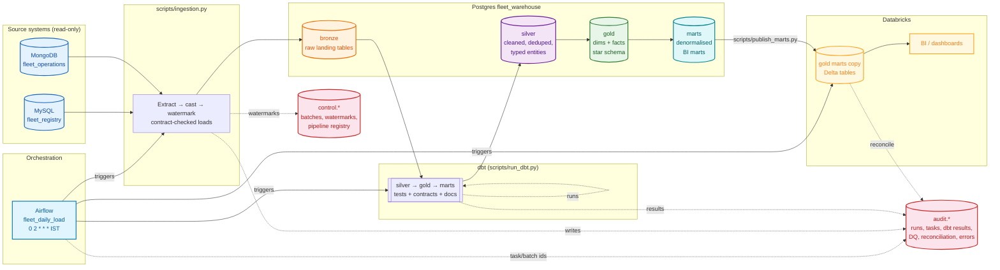

<p align="center">
  
</p>

<h1 align="center">Fleet DBT Warehouse</h1>

A daily analytics warehouse for fleet operations. MySQL `fleet_registry` and
MongoDB `fleet_operations` are landed in Postgres `bronze`, transformed by dbt
into `silver`, `gold` and `marts`, and approved non-PII marts are synced to
Databricks for BI. Airflow orchestrates the run; Python only moves data; dbt
owns every transformation.

## At a glance

| Concern | Choice |
|---|---|
| Source systems | MySQL `fleet_registry`, MongoDB `fleet_operations` |
| Landing | Postgres `bronze`, written only by `scripts/ingestion.py` |
| Transformation | dbt `silver` → `gold` → `marts` |
| Serving | Approved Postgres marts copied to Databricks by `scripts/publish_marts.py` |
| Orchestration | Airflow DAG `fleet_daily_load`, daily at `0 2 * * *` Asia/Kolkata |
| Entrypoint | `make` (`make help` lists every target) |
| Config | `.env` copied from `.env.example`; never commit real values |
| Contracts | `contracts/sources/*.yml`, checked by `make contracts-check` |
| Audit/control | Postgres `control.*` for state, `audit.*` for append-only evidence |

## Pipeline flow



### Layer colours

| Colour | Layer | Written by | Meaning |
|---|---|---|---|
| light blue | Orchestration | Airflow only | Schedules scripts; never moves or transforms data |
| 🟠 orange | `bronze` | `scripts/ingestion.py` only | Raw landing; immutable history of what arrived |
| 🟣 purple | `silver` | dbt only | One model per source table: dedupe, cast, validate |
| 🟢 green | `gold` | dbt only | Star schema: 7 SCD1 dims + `dim_date` + 6 facts |
| 🔵 teal | `marts` | dbt only | Denormalised, ratio-safe BI aggregates |
| 🔵 cyan | Databricks marts | `scripts/publish_marts.py` only | Synced copy of approved marts for BI |
| 🔴 pink | `control` / `audit` | Python + SQL functions | Run metadata, watermarks, evidence |

---

## Repository map

```text
.
├── AGENTS.md                  # rules and permissions for agents
├── CHANGELOG.md               # Keep a Changelog release history
├── CLAUDE.md                  # Claude-specific repository notes
├── LICENSE
├── Makefile                   # single entry point; run make help
├── pyproject.toml             # Python dependencies and pytest/Ruff config
├── uv.lock                    # locked dependency graph
├── .env.example               # every config knob, placeholders only
├── .githooks/                 # commit-msg and pre-push guards
│
├── contracts/                 # source-of-truth schemas for every landing table
│   ├── sources/               #   12 YAML contracts (mysql__*, mongo__*)
│   ├── samples/               #   12 sample JSON payloads
│   └── sources_index.json     #   contract index used by contracts-check
│
├── scripts/                   # runnable pipeline steps
│   ├── ingestion.py           #   MySQL + MongoDB → bronze, watermarks, audit
│   ├── run_dbt.py             #   dbt runner + audit artifact loader
│   ├── publish_marts.py       #   approved Postgres marts → Databricks
│   └── run_notebooks.py       #   reproducible notebook runner
│
├── utils/                     # shared plumbing imported by every script
│   ├── engine.py              #   .env loading and config knobs
│   ├── connection.py          #   PG / MySQL / Mongo / Databricks connections
│   ├── audit.py               #   task, error, DQ and reconciliation audit rows
│   ├── dbt_audit.py           #   dbt artifacts → audit.dbt_* tables
│   └── logger.py              #   quiet file logger
│
├── dbt/                       # dbt project (transformation owner)
│   ├── dbt_project.yml        #   schemas, vars and model defaults
│   ├── profiles.yml           #   Postgres targets (dev/prod)
│   ├── packages.yml           #   dbt package dependencies
│   ├── models/
│   │   ├── bronze/sources.yml #   source declarations (bronze.*)
│   │   ├── silver/            #   12 staging models + schema.yml
│   │   ├── gold/              #   13 dims/facts + schema.yml
│   │   └── marts/             #   6 BI marts + reconcile model + schema.yml
│   ├── macros/                #   cleaning, incremental, gold and mart helpers
│   └── tests/generic/silver/  #   11 project-specific generic tests
│
├── sql/
│   ├── scripts/               #   bootstrap 01..07 applied by make db-init
│   │   ├── 01_init_schema.sql
│   │   ├── 02_audit_tables.sql
│   │   ├── 03_control_pipeline_registry.sql
│   │   ├── 04_control_batch_tracking.sql
│   │   ├── 05_control_watermarks.sql
│   │   ├── 06_audit_relationships.sql
│   │   └── 07_pipeline_event_triggers.sql
│   └── metadata/              #   read-only inspection queries 01..10
│
├── airflow/                   # orchestration stack
│   ├── README.md              #   setup, DAG graph and operations
│   ├── Dockerfile
│   ├── compose.yml
│   ├── compose.dev.yml
│   ├── requirments-airflow.txt
│   ├── requirments-dev.txt
│   ├── dags/
│   │   ├── fleet_dbt_daliy.py #   daily ingest → dbt → publish
│   │   ├── fleet_report_weekly.py
│   │   └── fleet_watchdog.py
│   ├── helpers/
│   │   ├── scripts/           #   preflight, commands, callbacks, notify, audit
│   │   └── template/          #   text/HTML summary and failure templates
│   ├── scripts/               #   image entrypoint, init and healthcheck
│   └── tests/                 #   Airflow/DAG unit tests
│
├── docs/                      # guides and design notes
│   ├── DBT.md
│   ├── FINDING.md
│   └── TESTING.md
│
├── tests/                     # root pytest suite, markers follow the folder
│   ├── conftest.py
│   ├── unit/                  #   no network, no DB, no Docker
│   ├── integration/           #   throwaway Postgres built from sql/scripts/01..07
│   └── smoke/                 #   post-build and post-deploy liveness
│
├── helpers/                   # shell utilities
│   ├── check_health.sh
│   ├── db_backup.sh
│   ├── monitor_logs.sh
│   └── protect_env.sh
│
└── notebooks/                 # EDA notebooks
```

Generated and not committed: `.env`, `.venv/`, `dbt/target/`, `dbt/logs/`,
`dbt/dbt_packages/`, `logs/`, `out/` and Python caches.

## Quickstart

Prerequisites: `make`, Bash, `uv`, a PostgreSQL client (`psql`), and Docker if
you want the local Airflow stack. Live ingestion also needs read-only MySQL and
MongoDB credentials; publishing needs Databricks credentials.

```bash
cp .env.example .env          # fill in real values; never commit .env
make install
make env-check
make db-init CONFIRM=yes      # creates schemas, control/audit functions and triggers
make contracts-check
make ingest
make dbt-build ENV=dev
make publish-marts
```

`make help` is the authoritative command list. Common targets include
`make dbt-silver`, `make dbt-gold`, `make dbt-marts`, their `*-tests` variants,
`make dbt-test`, `make verify`, `make airflow-test` and `make notebooks`.

## Daily run

Airflow owns **when** the pipeline runs; the repository scripts own **what**
runs. The `fleet_daily_load` DAG follows:

```text
preflight → start_batch → ingestion tiers → ingest_done
          → silver_run → silver_test
          → gold_dims_run → gold_facts_run → gold_test
          → marts_run → marts_test → publish_marts → notify_summary
```

Each task passes the DAG id and run id to the scripts so warehouse batches tie
back to Airflow runs. Failures close their batch, write `audit.error_log` and
publish `pg_notify('pipeline_failure', json)`. Retry only transient connection
errors, never contract or data-test failures. Full Airflow setup, containers,
notifications and troubleshooting are in `airflow/README.md`.

## Configuration and safety

- Copy `.env.example` to `.env` and keep all credentials there. Never commit
  `.env`, tokens, passwords, connection strings or the PII salt.
- `SOURCE_MODE` selects `live`, `csv` or `fixture`; the same ingestion code path
  runs in all three.
- Use `Decimal`/`NUMERIC` for money, timezone-aware UTC timestamps and
  `contains_pii: true` on any model or column holding a sensitive value.
- `mart_driver_scorecard_monthly` stays in Postgres because it carries driver
  display names; it is never published to Databricks.
- Production work needs `ENV=prod CONFIRM=yes`; full refresh, backfills and
  Databricks writes need explicit approval.

## Tests and checks

```bash
make lint-fast
make py-test
make py-unit
make py-integration
make py-smoke
make contracts-check
make airflow-test
make dbt-parse ENV=dev
```

`make verify` runs lint and Python tests; `make ci` still aliases `verify`.
GitHub Actions adds the full PR/push pipeline, fixture-backed dbt build, image
build and smoke check, staging deploy and manually approved production deploy.
See `docs/TESTING.md` for the full inventory, current test counts, helper
checks, git hooks, workflow secrets and known gaps. See `docs/DBT.md` for dbt
sources, layers, macros, variables and dbt commands.

Current implementation notes: dbt profiles are `dev`, `ci` and `prod`;
`contracts-check` validates contract/source name alignment but not column-level
drift; dbt model contracts are not enforced yet; no dbt unit tests or snapshots
are committed yet.

## Documentation

- `docs/DBT.md` — dbt sources, models, macros, vars and commands.
- `docs/TESTING.md` — every test and check currently in the repo.
- `airflow/README.md` — orchestration stack, DAG graph and operations.
- `contracts/README.md` — source contract format and ownership.
- `CHANGELOG.md` — notable changes and contract-change history.
- `AGENTS.md` — repository rules, permissions and definition of done.
