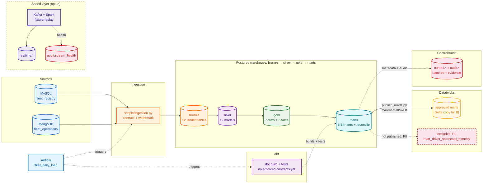
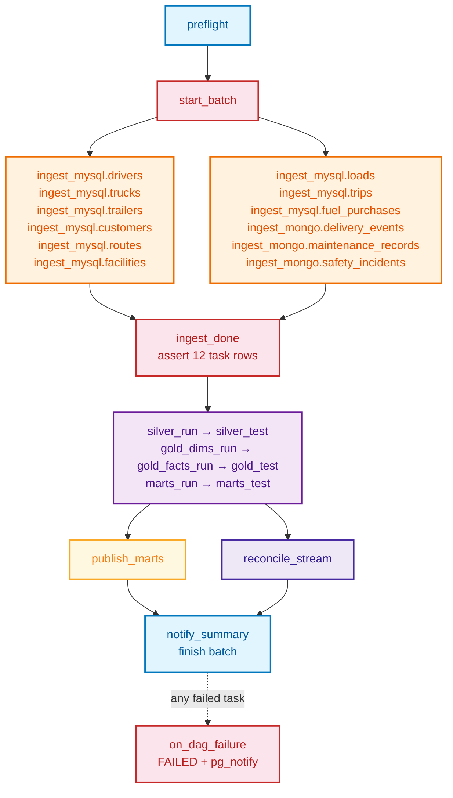
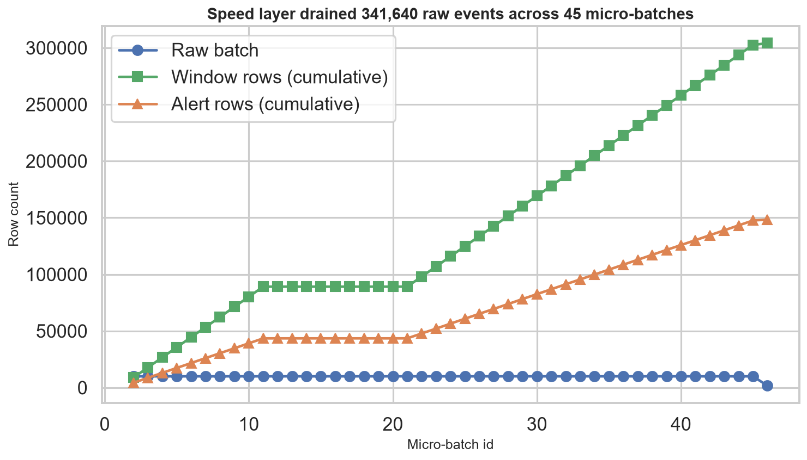
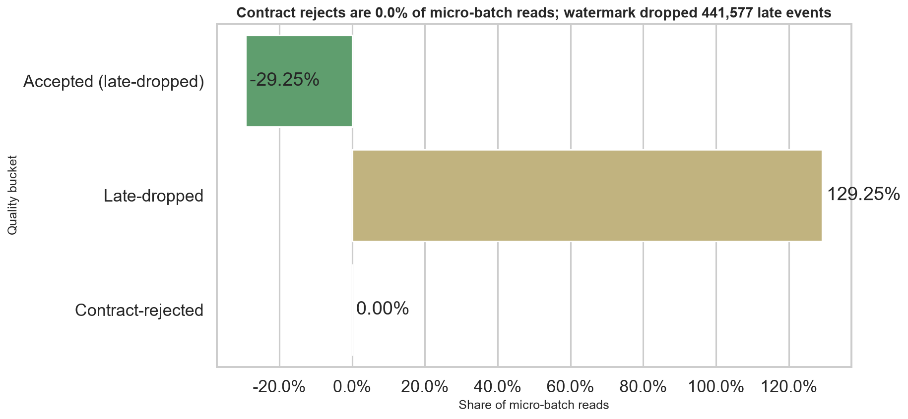

<p align="center"></p>

<h1 align="center">Fleet dbt Warehouse</h1>

A daily analytics warehouse for logistics operations: MySQL `fleet_registry` and MongoDB `fleet_operations` land in PostgreSQL `bronze`, dbt builds `silver`, `gold` and marts, and approved non-PII marts reach Databricks under Airflow orchestration.

<p align="center">
  <a href="https://github.com/Nitinx12/Fleet-dbt-warehouse/actions/workflows/ci.yml"></a>
  <a href="LICENSE"></a>
  <a href="https://github.com/Nitinx12/Fleet-dbt-warehouse/commits/main"></a>
</p>

## Tech stack

| Layer | Tools |
|---|---|
| **Sources** |   |
| **Ingestion** |     |
| **Warehouse** |  |
| **Transformation** |    |
| **Serving copy** |   |
| **Orchestration** |    |
| **Presentation** |   |
| **Infra & dev tooling** |       |
| **CI, delivery & quality** |     |

---

## Highlights

- 12 source tables (9 MySQL, 3 MongoDB) feed 32 dbt models: 12 silver, 13 gold and 7 marts.
- 5 approved marts publish to Databricks; `mart_driver_scorecard_monthly` is excluded because it carries a driver display name.
- 383 dbt tests and 118 collected Python/Airflow tests; 12 source contracts are checked by `make contracts-check`.
- `fleet_daily_load` runs at `0 2 * * *` in `Asia/Kolkata`, with batches and watermarks in `control.*` and `audit.*`.
- PII is reduced early: licence numbers hashed, dates of birth banded, fuel cards masked, one driver mart excluded.
- The opt-in Kafka/Spark speed layer writes only `realtime.*` and `audit.stream_health`.

## Architecture



The batch path above is the governed warehouse. Two observers run alongside it: the opt-in Kafka/Spark speed layer writes only `realtime.*` plus append-only health rows, and the Streamlit site reads only three `audit` views. Neither gates the daily batch. See the [Kafka runbook](kafka/README.md) and [architecture section 8](ARCHITECTURE.md#8-streamlit-project-site).

### Layer colours

| Colour | Class | Used for |
|---|---|---|
| blue | `src` | MySQL and MongoDB sources |
| orange | `bronze` | Landed tables and ingestion |
| purple | `silver` | Staging, build and tests |
| green | `gold` | Seven dimensions, including `dim_date`, and six facts |
| teal | `mart` | Six BI marts plus one reconciliation model |
| amber | `bi` | Databricks and dashboards |
| pink | `ctrl` | Control, audit and blocked PII paths |
| light blue | `orch` | Airflow |
| violet | `speed` | Kafka, Spark and `realtime.*` |

---

## Daily run



DAG file: `airflow/dags/fleet_dbt_daliy.py`. Schedule: `0 2 * * *` in `Asia/Kolkata`; `catchup=False`, `max_active_runs=1`, 6-hour timeout. Ingest: 2 retries, 5–30 minute backoff, 45-minute timeout, pools `mysql_pool`/`mongo_pool`; dbt: no retries; publish: 1 retry after 10 minutes, 90-minute timeout. `on_dag_failure` closes the batch as `FAILED` and sends one redacted alert; the database trigger emits `pg_notify`.

## Project at a glance

| Metric | Value | Source |
|---|---|---|
| Source tables / collections | 12 (9 MySQL, 3 MongoDB) | `contracts/sources/*.yml` |
| dbt models | 32 (12 silver, 13 gold, 7 marts) | `dbt/target/manifest.json` |
| dbt tests | 383 (348 error, 35 warn) | `dbt/target/manifest.json` |
| Published marts | 5 | `scripts/publish_marts.py` |
| Python/Airflow tests | 118 collected (84 + 34) | pytest collection |
| CI jobs | 9, plus 1 secret-scan job | `.github/workflows/` |

## Data quality and testing

383 dbt tests split 134 silver, 198 gold and 51 marts. Python has 84 collected tests and Airflow 34; 12 contracts are checked and CI has 9 jobs plus Gitleaks. There are no enforced dbt contracts. Full gate table: [data quality](docs/DATA_QUALITY.md); inventory: [testing](docs/TESTING.md).

## Key design decisions

dbt owns transformation and Python only moves data. Watermark lookback, one writer per layer, current-state SCD1 dimensions and a five-mart publication allowlist keep replay deterministic and PII out of Databricks. Full trade-offs: [design decisions](docs/DESIGN_DECISIONS.md).

## Mart layer

| Mart | Grain | Published |
|---|---|---|
| `mart_sales_daily` | Load date × customer × route | Yes |
| `mart_equipment_utilization_daily` | Dispatch date × truck × trailer | Yes |
| `mart_delivery_performance_daily` | Scheduled date × facility × event type | Yes |
| `mart_driver_scorecard_monthly` | Month × driver | No — driver display name |
| `mart_customer_service_monthly` | Month × customer | Yes |
| `mart_truck_cost_monthly` | Month × truck | Yes |

`assert_marts_reconcile_to_facts` is the seventh model in `dbt/models/marts/`; it is a reconciliation table, not a BI mart.

## Business insights

Full analysis: [reports/INSIGHT.md](reports/INSIGHT.md). Charts and findings are regenerated from `gold` tables by `make report`. Figures come from a populated synthetic dataset behind the committed report artefacts; `make demo` loads only small `contracts/samples` fixtures and full `data/` extracts are not tracked.

| Question | Finding | Source |
| --- | --- | --- |
| Where is revenue concentrated? | First Group generated $9.14M (3.5% of load revenue); the top 10 customers generated 19.8%. | `reports/findings/01_revenue_concentration.json` |
| Where does service perform worst? | Atlanta Distribution Center had the lowest high-volume on-time rate at 53.4%. | `reports/findings/02_delivery_service.json` |
| Where is cost risk concentrated? | 170 safety incidents produced $2.65M in claims; 37.6% were preventable. | `reports/findings/05_safety.json` |
| Did the Kafka speed layer hold up? | 45 micro-batches drained 341,640 lifecycle events with 0 contract rejects; on-time share 55.7% matched gold. | `reports/findings/08_streaming.json` |

### Detailed insight: delivery on-time rate and detention cost

Overall on-time performance was **55.7%** across **170,820** delivery events, with estimated detention cost of **$19.5M** at $75/hour. Atlanta Distribution Center was the weakest high-volume facility at **53.4% on time** across 3,278 events and **$379K** estimated detention. First Group was the highest detention-cost customer at **$689K** across 6,002 events.


**So what:** Low on-time rates and long dwells compound: missed appointments consume capacity, add detention charges, and weaken customer trust. Start with a root-cause review at Atlanta Distribution Center and First Group dwell limits, then track on-time rate and detention cost per customer after changes.

Source: `gold.fct_delivery_events` joined to `gold.dim_facilities` and `gold.dim_customers`; chart generated by `reports/scripts/02_delivery_service.py`.

### Detailed insight: Kafka speed layer held the contract end-to-end

A full fixture replay into `dev.fleet.delivery_events.v1` was consumed by Spark in **45 micro-batches**, landing **341,640** lifecycle rows (170,820 ARRIVED / 170,820 DEPARTED) with **0 contract rejects**. On-time share in `realtime.delivery_events_raw` was **55.7%**, matching gold. The watchdog peaked at **147,517** messages of backlog while draining (expected for a large replay at `maxOffsetsPerTrigger=10000`), and detention alerts settled at **147,978 RESOLVED / 370 OPEN**.





**So what:** Zero rejects and a balanced lifecycle split show the strict contract, producer and DLQ path stayed aligned under load. Treat lag as transient drain signal (not broker failure) until the watchdog returns `OK topic-high-low`; the OPEN detention alerts are the live operator queue.

Source: `audit.stream_health`, `realtime.*`, `control.stream`; chart generated by `reports/scripts/08_streaming.py`.

## Limitations and known gaps

- Coverage: Not configured; typical run time and largest table loaded: Not measured.
- dbt contracts are not enforced (0 of 32); there are no dbt unit tests or snapshots.
- 35 `warn` tests are gold and mart `relationships` checks; Airflow assets and stale-batch cleanup are not implemented.

## Repository map

```text
├── AGENTS.md / CLAUDE.md                   # agent rules and Claude-specific notes
├── CHANGELOG.md                            # Keep a Changelog release history
├── Makefile                                # single entry point; run make help
├── app.py / index.html                     # Streamlit host and project site
├── pyproject.toml / uv.lock                # dependencies, pytest and Ruff config
├── requirements.txt                        # Streamlit runtime dependencies
├── .env.example                            # every config knob, placeholders only
├── .githooks/                              # commit-msg and pre-push guards
├── .streamlit/                             # Streamlit config and live audit payload helper
│   └── streamlit_state.py                  # builds the embedded audit JSON
├── assets/                                 # logo and committed screenshots
│   ├── logo/
│   └── screenshots/pipeline_flow.svg
├── contracts/                              # source-of-truth schemas: 12 sources, 1 stream, samples
├── scripts/                                # runnable pipeline steps
│   ├── ingestion.py                        # MySQL + MongoDB → bronze, watermarks, audit
│   ├── run_dbt.py                          # dbt runner + audit artifact loader
│   ├── publish_marts.py                    # approved Postgres marts → Databricks
│   ├── run_notebooks.py                    # reproducible notebook runner
│   └── stream_*.py                         # thin Kafka/Spark/stream-admin launchers
├── utils/                                  # shared plumbing: config, connections, audit, logger
│
├── dbt/                                    # transformation layer
│   ├── models/                             # bronze sources, silver (12), gold (13), marts (7)
│   ├── macros/                             # cleaning, incremental, gold and mart helpers
│   └── tests/generic/silver/               # project-specific generic tests
│
├── sql/
│   ├── scripts/                            # bootstrap 01..08 applied by make db-init
│   └── metadata/                           # read-only inspection queries
│
├── airflow/                                # orchestration stack (Dockerfile, compose, README)
│   ├── dags/                               # fleet_dbt_daliy, fleet_report_weekly, fleet_watchdog
│   ├── helpers/                            # preflight, callbacks, notify, templates
│   └── tests/                              # DAG unit tests
│
├── kafka/                                  # opt-in speed layer: contract, package, image, tests
│   ├── fleet_stream/                       # producer, Spark job, admin and monitor modules
│   ├── Dockerfile/compose.yml              # streaming image and `streaming` profile
│   └── README.md                           # runbook for replay, health and reset
│
├── docs/                                   # DBT.md, FINDING.md, TESTING.md
├── tests/                                  # unit / integration / smoke
├── helpers/                                # shell utilities (health, backup, logs, env protection)
└── notebooks/                              # EDA notebooks
```

## Makefile

`make help` is the authoritative target list. Full list: [Make targets](docs/MAKEFILE.md). Configuration: `ENV=dev|ci|prod`, `SELECT=<dbt selector>`, `EXCLUDE=<resource type>`, `CONFIRM=yes`, `V=1`.

<details>
<summary>Common commands</summary>

```bash
# Setup and local checks
make install                                                    # create/update .venv from uv.lock
make check-tools                                                # verify bash, uv and awk
make env-check                                                  # verify required environment variables
make contracts-check                                            # validate contract index and dbt bronze sources
make lint-fast                                                  # Ruff lint and format check
make py-test                                                    # run Python test suite
make verify                                                     # lint-fast + py-test; aliases: make ci, make check

# Zero-credential fixture demo in fleet_dev
make demo                                                       # build fixture demo in fleet_dev

# Warehouse bootstrap and ingestion
make db-init CONFIRM=yes                                        # create database and apply bootstrap scripts
make ingest ENV=dev                                             # load MySQL/Mongo sources into bronze

# dbt
make dbt-deps                                                   # install dbt packages
make dbt-parse ENV=dev                                          # parse dbt project
make dbt-build ENV=dev                                          # run dbt models and tests
make dbt-test ENV=dev                                           # run dbt tests
make dbt-docs ENV=dev                                           # generate dbt docs
make dbt-build ENV=dev SELECT=my_model+                         # build selected model and downstream

# One layer at a time
make dbt-silver ENV=dev && make dbt-silver-tests ENV=dev        # run and test silver
make dbt-gold ENV=dev && make dbt-gold-tests ENV=dev            # run and test gold
make dbt-marts ENV=dev && make dbt-marts-tests ENV=dev          # run and test marts

# Publishing and Airflow
make publish-marts ENV=dev                                      # publish approved marts to Databricks
make airflow-test                                               # run Airflow orchestration tests
make airflow-up                                                 # start local Airflow stack
make airflow-down                                               # stop local Airflow stack

# Streamlit project site
make streamlit                                                  # serve app.py with the live audit panel

# Opt-in Kafka speed layer
make stream-up                                                  # start Kafka, topics, registry and supervised job
make stream-produce                                             # replay fixture or live delivery_events
make stream-status                                              # show registration and latest health evidence
make stream-monitor                                             # probe Kafka lag and freshness once
make stream-reconcile BATCH_ID=42                               # compare realtime with gold observationally
make stream-demo                                                # zero-credential fixture replay into fleet_dev
make stream-reset CONFIRM=yes                                   # drop checkpoints and truncate realtime only
make stream-test                                                # run broker-free streaming unit tests

# Reports and cleanup
make report                                                     # build charts and findings JSON
make report-clean                                               # remove generated report artifacts
make clean                                                      # remove caches and generated output
```

</details>

## Author, contact and licence

Nitin — [GitHub @Nitinx12](https://github.com/Nitinx12) · nitin321x@gmail.com

Released under the [MIT License](LICENSE).
