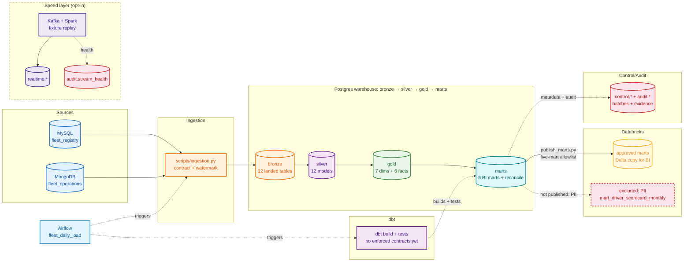
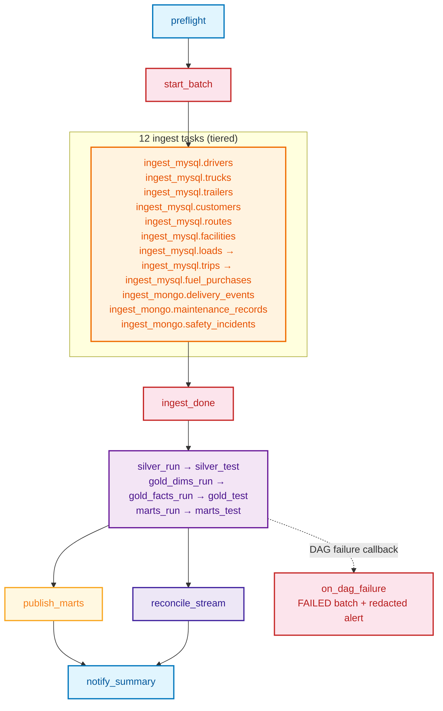

<p align="center"></p>

<h1 align="center">Fleet dbt Warehouse</h1>

<p align="center">Daily fleet warehouse: MySQL and MongoDB → PostgreSQL <code>bronze</code> → dbt <code>silver</code>, <code>gold</code> and marts → approved marts in Databricks, orchestrated by Airflow.</p>

<p align="center">
  <a href="https://github.com/Nitinx12/Fleet-dbt-warehouse/actions/workflows/ci.yml"></a>
  <a href="LICENSE"></a>
  <a href="https://github.com/Nitinx12/Fleet-dbt-warehouse/commits/main"></a>
</p>

<p align="center">Live Streamlit site: TODO (none recorded); run <code>make streamlit</code> locally.</p>

## Highlights

- 12 source tables (9 MySQL, 3 MongoDB) feed 32 dbt models: 12 silver, 13 gold and 7 marts.
- 5 approved marts publish to Databricks; `mart_driver_scorecard_monthly` is excluded because it carries a driver display name.
- 383 dbt tests and 118 collected Python/Airflow tests; 12 source contracts are checked by `make contracts-check`.
- `fleet_daily_load` runs at `0 2 * * *` in `Asia/Kolkata`, with batches and watermarks in `control.*` and `audit.*`.
- PII is reduced early: licence numbers hashed, dates of birth banded, fuel cards masked, one driver mart excluded.
- The opt-in Kafka/Spark speed layer writes only `realtime.*` and `audit.stream_health`.

## Quick start

Prerequisites: Docker Compose for Airflow; `uv`, Python 3.12, `bash`, `awk` and `psql` locally.

```bash
make install
make demo
make streamlit
```

Open the URL printed by Streamlit. For Airflow, create `.env` from `.env.example`, run `make airflow-up`, open `http://localhost:8080`, then unpause `fleet_daily_load`. See the [deployment guide](DEPLOYMENT.md).

## Architecture



### Layer colours

| Colour | Class | Used for |
|---|---|---|
| Blue | `src` | MySQL and MongoDB |
| Orange | `bronze` | Landed tables and ingestion |
| Purple | `silver` | dbt staging and the build node |
| Green | `gold` | Dimensions and facts |
| Teal | `mart` | BI marts |
| Amber | `bi` | Databricks and dashboards |
| Pink | `ctrl` | Control, audit and the excluded note |
| Light blue | `orch` | Airflow |
| Violet | `speed` | Kafka, Spark and `realtime.*` |

Solid arrows are data flow; dotted arrows are metadata and audit evidence. dbt owns transformations; `bronze` stays immutable and gold is SCD1. The independent speed layer never enters the batch; five marts publish and the PII driver scorecard is blocked. Details: [architecture](ARCHITECTURE.md), [guide](docs/ARCHITECTURE.md).

## Daily run



DAG file: `airflow/dags/fleet_dbt_daliy.py`. Schedule: `0 2 * * *` in `Asia/Kolkata`; `catchup=False`, `max_active_runs=1`, 6-hour timeout. Ingest: 2 retries, 5–30 minute backoff, 45-minute timeout, pools `mysql_pool`/`mongo_pool`; dbt: no retries; publish: 1 retry after 10 minutes, 90-minute timeout. `on_dag_failure` closes the batch as `FAILED` and sends one redacted alert; the database trigger emits `pg_notify`.

## Tech stack

| Area | Tools |
|---|---|
| Sources | MySQL, MongoDB |
| Warehouse | PostgreSQL |
| Transformation | dbt Core, dbt-postgres |
| Orchestration | Airflow 3.3.2, CeleryExecutor, Redis |
| Serving | Databricks Delta, Streamlit, Plotly |
| Speed and CI | Kafka, Spark, Docker Compose, uv, Ruff, pytest, GitHub Actions |

## Project at a glance

| Metric | Value | Source |
|---|---|---|
| Source tables / collections | 12 (9 MySQL, 3 MongoDB) | `contracts/sources/*.yml` |
| dbt models | 32 (12 silver, 13 gold, 7 marts) | `dbt/target/manifest.json` |
| dbt tests | 383 (348 error, 35 warn) | `dbt/target/manifest.json` |
| Published marts | 5 | `scripts/publish_marts.py` |
| Python/Airflow tests | 118 collected (84 + 34) | pytest collection |
| CI jobs | 9, plus 1 secret-scan job | `.github/workflows/` |

## Data quality and testing

383 dbt tests split 134 silver, 198 gold and 51 marts. Python has 84 collected tests and Airflow 34; 12 contracts are checked and CI has 9 jobs plus Gitleaks. There are no enforced dbt contracts. Full gate table: [data quality](docs/DATA_QUALITY.md); inventory: [testing](docs/TESTING.md).

## Key design decisions

dbt owns transformation and Python only moves data. Watermark lookback, one writer per layer, current-state SCD1 dimensions and a five-mart publication allowlist keep replay deterministic and PII out of Databricks. Full trade-offs: [design decisions](docs/DESIGN_DECISIONS.md).

## Mart layer

| Mart | Grain | Published |
|---|---|---|
| `mart_sales_daily` | Load date × customer × route | Yes |
| `mart_equipment_utilization_daily` | Dispatch date × truck × trailer | Yes |
| `mart_delivery_performance_daily` | Scheduled date × facility × event type | Yes |
| `mart_driver_scorecard_monthly` | Month × driver | No — driver display name |
| `mart_customer_service_monthly` | Month × customer | Yes |
| `mart_truck_cost_monthly` | Month × truck | Yes |

`assert_marts_reconcile_to_facts` is the seventh model in `dbt/models/marts/`; it is a reconciliation table, not a BI mart.

## Business insights

Figures come from synthetic data behind committed report artefacts; `make demo` loads only small `contracts/samples` fixtures and full `data/` extracts are not tracked. More: [reports/INSIGHT.md](reports/INSIGHT.md); EDA: [docs/FINDING.md](docs/FINDING.md).

### Delivery service: on-time rate and detention cost

Overall on-time performance was **55.7%** across **170,820** delivery events, with estimated detention cost of **$19.5M** at $75/hour. Atlanta Distribution Center was weakest high-volume facility at **53.4%** (3,278 events, **$379K** detention); First Group had the highest cost at **$689K** (6,002 events). Start with dwell-limit and root-cause reviews, then track both measures per customer. Source: `reports/findings/02_delivery_service.json`.

## Limitations and known gaps

- Live site: TODO; coverage: Not configured; run time and largest table: Not measured.
- dbt contracts are not enforced (0 of 32); there are no dbt unit tests or snapshots.
- 35 `warn` tests are gold and mart `relationships` checks; Airflow assets and stale-batch cleanup are not implemented.

## Repository map

```text
.
├── root: AGENTS.md, ARCHITECTURE.md, CHANGELOG.md, CLAUDE.md, CONTRIBUTING.md, DEPLOYMENT.md, LICENSE, Makefile, README.md, SECURITY.md, app.py, index.html, pyproject.toml, requirements.txt, uv.lock
├── dotfiles: .dockerignore, .editorconfig, .env.example, .gitattributes, .gitignore, .gitleaks.toml, .prettierrc.json, .python-version
├── .devcontainer/, .githooks/, .streamlit/, helpers/, notebooks/, scripts/, tests/, utils/
├── .github/: CODEOWNERS, PULL_REQUEST_TEMPLATE.md, ISSUE_TEMPLATE/, workflows/
├── airflow/: Dockerfile, README.md, compose.dev.yml, compose.yml, dags/, helpers/, requirments-airflow.txt, requirments-dev.txt, scripts/, tests/
├── assets/, contracts/: README.md, sources_index.json, samples/, sources/, streams/
├── dbt/: .gitignore, README.md, dbt_project.yml, package-lock.yml, packages.yml, profiles.yml, macros/, models/, tests/
├── docs/: ARCHITECTURE.md, DBT.md, DATA_QUALITY.md, DEPLOYMENT.md, DESIGN_DECISIONS.md, FINDING.md, MAKEFILE.md, REPO_MAP.md, SCREENSHOTS.md, TESTING.md, adr/
├── kafka/: Dockerfile, README.md, compose.yml, config/, fleet_stream/, tests/
├── reports/: .gitignore, INSIGHT.md, __init__.py, findings/, helpers/, img/, scripts/
└── sql/: metadata/, scripts/
```

Full tree: [docs/REPO_MAP.md](docs/REPO_MAP.md).

## Makefile

Full list: [docs/MAKEFILE.md](docs/MAKEFILE.md); `make help` is authoritative.

```bash
make install
make demo
make env-check
make contracts-check
make lint-fast
make py-test
make verify
make db-init CONFIRM=yes
make ingest ENV=dev
make dbt-build ENV=dev
```

## Author, contact and licence

Nitin — [GitHub @Nitinx12](https://github.com/Nitinx12) · nitin321x@gmail.com

Released under the [MIT License](LICENSE).
