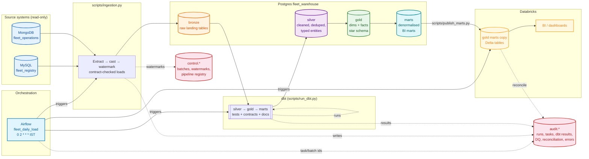
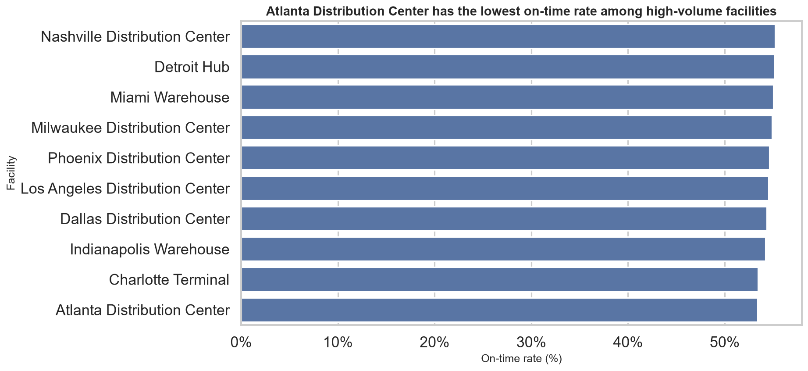
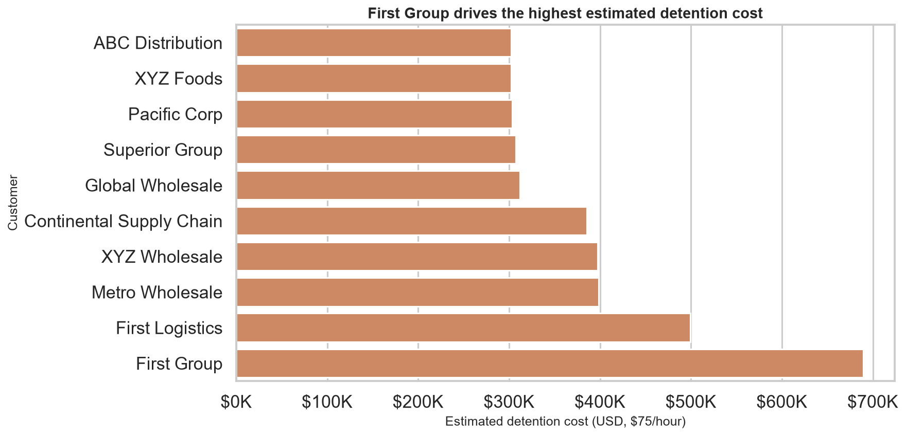
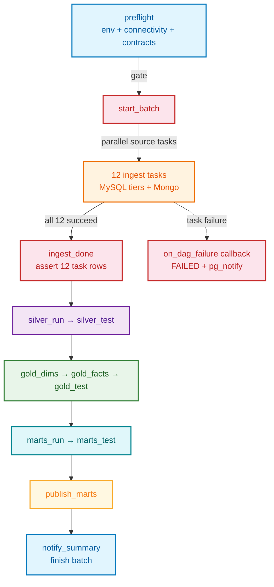

<p align="center">
  
</p>

<h1 align="center">Fleet DBT Warehouse</h1>

<p align="center">
A daily analytics warehouse for logistics operations that uses watermark-based micro-batch processing to ingest data from MySQL `fleet_registry` and MongoDB `fleet_operations` into PostgreSQL `bronze`. dbt transforms the data through `silver`, `gold`, and `marts`, with approved non-PII marts published to Databricks for BI. Airflow orchestrates daily workflows, Makefile provides a unified entry point, Python handles data movement, and dbt owns all transformations.
</p>

---

## Tech stack

| Layer | Tools |
|---|---|
| **Sources** |   |
| **Orchestration** |  |
| **Transformation** |   |
| **Warehouse** |   |
| **Visualization** |  |
| **Infra & Dev tooling** |      |

---

## Highlights

- **12 → 32 → 5:** 12 source tables (9 MySQL, 3 MongoDB) feed 32 dbt models (12 silver, 13 gold, 7 marts); 5 BI marts are published to Databricks.
- **415 nodes pass in one command:** `make demo` lands contract samples and builds 32 models plus 383 dbt tests on `fleet_dev` with no source or Databricks credentials.
- **Tested at every boundary:** 383 dbt tests, 104 collected Python/Airflow test cases, 12 source contracts, and 7 GitHub Actions jobs plus a secret scan.
- **Daily, observable runs:** Airflow DAG `fleet_daily_load` runs at `0 2 * * *` Asia/Kolkata; batches, watermarks, task outcomes, dbt results, and reconciliation are stored in `control.*` and `audit.*`.
- **PII is designed out early:** licence numbers are hashed, dates of birth become age bands, fuel cards are masked, and the one PII-tagged mart is excluded from publication.
- **Numbers you can reproduce:** 7 chart scripts regenerate 17 PNGs and 7 JSON findings files with `make report`; charts read populated `gold` tables and write no database rows.

## Architecture



## Layer colours

| Colour | Layer | Written by | Meaning |
|---|---|---|---|
| light blue | Orchestration | Airflow only | Schedules scripts; never moves or transforms data |
| 🟠 orange | `bronze` | `scripts/ingestion.py` only | Raw landing; immutable history of what arrived |
| 🟣 purple | `silver` | dbt only | One model per source table: dedupe, cast, validate |
| 🟢 green | `gold` | dbt only | Star schema: 7 SCD1 dims + `dim_date` + 6 facts |
| 🔵 teal | `marts` | dbt only | Denormalised, ratio-safe BI aggregates |
| 🔵 cyan | Databricks marts | `scripts/publish_marts.py` only | Synced copy of approved marts for BI |
| 🔴 pink | `control` / `audit` | Python + SQL functions | Run metadata, watermarks, evidence |
---

## Business insights

Full analysis: [reports/INSIGHT.md](reports/INSIGHT.md). Charts and findings are regenerated from `gold` tables by `make report`.

| Question | Finding | Source |
| --- | --- | --- |
| Where is revenue concentrated? | First Group generated $9.13M (3.5% of load revenue); the top 10 customers generated 19.8%. | `reports/findings/01_revenue_concentration.json` |
| Where does service perform worst? | Atlanta Distribution Center had the lowest high-volume on-time rate at 53.4%. | `reports/findings/02_delivery_service.json` |
| Where is cost risk concentrated? | 170 safety incidents produced $2.65M in claims; 37.6% were preventable. | `reports/findings/05_safety.json` |

### Detailed insight: delivery service is the margin leak

Overall on-time performance was **55.7%** across **170,820** delivery events, with estimated detention cost of **$19.5M** at $75/hour. Atlanta Distribution Center was the weakest high-volume facility at **53.4% on time** across 3,278 events and **$379K** estimated detention. First Group was the highest detention-cost customer at **$689K** across 6,002 events.





**So what:** Low on-time rates and long dwells compound: missed appointments consume capacity, add detention charges, and weaken customer trust. Start with a root-cause review at Atlanta Distribution Center and First Group dwell limits, then track on-time rate and detention cost per customer after changes.

Source: `gold.fct_delivery_events` joined to `gold.dim_facilities` and `gold.dim_customers`; chart generated by `reports/scripts/02_delivery_service.py`.

---

| Metric | Value | How measured |
| --- | --- | --- |
| Source tables / collections | 12 | `contracts/sources/*.yml`: 9 MySQL + 3 MongoDB; `make contracts-check` |
| dbt models | 32 | `dbt/target/manifest.json`: 12 silver + 13 gold + 7 marts |
| Marts published | 5 | Publisher allowlist in `scripts/publish_marts.py`; 6 BI marts exist, driver scorecard excluded |
| DQ checks across layers | 383 | `dbt/target/manifest.json`: 348 error severity + 35 warn severity |
| Automated tests | 104 collected | 73 root pytest cases + 31 Airflow cases; `make py-test` runs the root 73 |
| Source contracts | 12 | `contracts/sources_index.json` and `make contracts-check` |
| Generated report charts | 17 | `reports/img/*.png`, regenerated by `make report` |
| Test coverage | Not configured | No coverage plugin, gate, or `make cov` target in this repo |
| Typical full-run time | Not measured | No scheduled-run timing artifact exists; `audit.pipeline_run_log` stores outcomes, not a published median |
| Largest table loaded | Not measured | No table-size artifact is committed; `reports/findings/*.json` holds business row counts only |


Details: [architecture](docs/ARCHITECTURE.md) · [deployment](docs/DEPLOYMENT.md) · [dbt guide](docs/DBT.md).

---

## Key design decisions

| Choice | Alternative rejected | Trade-off |
|---|---|---|
| dbt owns transformation; Python only moves data | SQL inside ingestion or stored procedures | One lineage and one test surface, at the cost of moving more bytes into `bronze` first. |
| Watermark micro-batches with a lookback | Nightly full-table replacement | Handles late and changed rows without full reloads; watermark resets and reprocessing windows must be monitored. |
| One writer per layer | Multiple services patching shared schemas | Replay and incident triage stay deterministic; cross-layer convenience writes are deliberately blocked. |
| Current-state SCD1 dimensions | SCD2 history on every dimension | Simpler, faster BI; historical attribution is not possible until snapshots are added. |
| Five-mart publication allowlist | Publish every `serve: true` model | Keeps PII and unreviewed models out of Databricks; new BI grains require a reviewed PR. |

---

## Mart Layer

| Mart | Grain | Business question | Published |
|---|---|---|---|
| `mart_sales_daily` | Load date × customer × route | What was booked, where, and for whom? | Yes |
| `mart_equipment_utilization_daily` | Dispatch date × truck × trailer | How efficiently is each asset used? | Yes |
| `mart_delivery_performance_daily` | Scheduled date × facility × event type | Are we on time, and where do stops go wrong? | Yes |
| `mart_driver_scorecard_monthly` | Month × driver | Which drivers perform best or worst? | No — contains a driver display name |
| `mart_customer_service_monthly` | Month × customer | Which accounts are healthy? | Yes |
| `mart_truck_cost_monthly` | Month × truck | Which trucks cost most to run and why? | Yes |

`assert_marts_reconcile_to_facts` is a seventh model in `marts/`: a table that returns rows only when a mart no longer adds back to its source fact. It is not one of the six BI marts.

---

## Data quality and testing

| Gate | What it covers | Current count | Command |
|---|---|---:|---|
| dbt tests | Keys, nulls, ranges, accepted values, scale, date order, flags, relationships | 383 (348 error, 35 warn) | `make dbt-test ENV=ci` |
| dbt tests by layer | silver 134 · gold 198 · marts 51 | 383 | `make dbt-build ENV=ci` |
| Python tests | Ingestion, fixtures, publishing, audit, connections, Makefile guards | 73 collected | `make py-test` |
| Airflow tests | DAG structure, tiers, callbacks, redaction, command builders | 31 collected | `PYTHONPATH=airflow uv run --no-sync pytest airflow/tests` |
| Contracts | Index ↔ YAML ↔ dbt bronze source names | 12 sources | `make contracts-check` |
| CI | Lint, unit tests, contracts, dbt parse, Airflow, integration, image smoke | 7 jobs | `.github/workflows/ci.yml` |
| Secret scan | Full-history Gitleaks | 1 workflow | `.github/workflows/leaks.yml` |

The 35 `warn` tests are gold/mart `relationships` checks; silver relationships are error-severity. There are no dbt unit tests, snapshots, or enforced model contracts yet. Full inventory and gaps: [TESTING.md](docs/TESTING.md).

---

## Daily run



`fleet_daily_load` uses `0 2 * * *` in `Asia/Kolkata`, `catchup=False`, `max_active_runs=1`, a 6-hour DAG timeout, and one active `control.batch` per pipeline. Ingestion tasks retry twice with exponential backoff; dbt tasks do not retry automatically. See [Airflow README](airflow/README.md).

---

## Repository map

```text
├── AGENTS.md / CLAUDE.md      # agent rules and Claude-specific notes
├── CHANGELOG.md               # Keep a Changelog release history
├── Makefile                   # single entry point; run make help
├── pyproject.toml / uv.lock   # dependencies, pytest and Ruff config
├── .env.example               # every config knob, placeholders only
├── .githooks/                 # commit-msg and pre-push guards
│
├── contracts/                 # source-of-truth schemas: 12 sources, 1 stream, samples
├── scripts/                   # runnable pipeline steps
│   ├── ingestion.py           #   MySQL + MongoDB → bronze, watermarks, audit
│   ├── run_dbt.py             #   dbt runner + audit artifact loader
│   ├── publish_marts.py       #   approved Postgres marts → Databricks
│   ├── run_notebooks.py       #   reproducible notebook runner
│   └── stream_*.py            #   thin Kafka/Spark/stream-admin launchers
├── utils/                     # shared plumbing: config, connections, audit, logger
│
├── dbt/                       # transformation layer
│   ├── models/                #   bronze sources, silver (12), gold (13), marts (6)
│   ├── macros/                #   cleaning, incremental, gold and mart helpers
│   └── tests/generic/silver/  #   project-specific generic tests
│
├── sql/
│   ├── scripts/               #   bootstrap 01..08 applied by make db-init
│   └── metadata/              #   read-only inspection queries
│
├── airflow/                   # orchestration stack (Dockerfile, compose, README)
│   ├── dags/                  #   fleet_dbt_daliy, fleet_report_weekly, fleet_watchdog
│   ├── helpers/               #   preflight, callbacks, notify, templates
│   └── tests/                 #   DAG unit tests
│
├── kafka/                     # opt-in speed layer: contract, package, image, tests
│   ├── fleet_stream/          #   producer, Spark job, admin and monitor modules
│   ├── Dockerfile/compose.yml #   streaming image and `streaming` profile
│   └── README.md              #   runbook for replay, health and reset
│
├── docs/                      # DBT.md, FINDING.md, TESTING.md
├── tests/                     # unit / integration / smoke
├── helpers/                   # shell utilities (health, backup, logs, env protection)
└── notebooks/                 # EDA notebooks
```
---

## Makefile Commands

`make help` is the authoritative target list. Configuration: `ENV=dev|ci|prod`, `SELECT=<dbt selector>`, `EXCLUDE=<resource type>`, `CONFIRM=yes`, `V=1`.

```bash
# Setup and local checks
make install                                # create/update .venv from uv.lock
make check-tools                            # verify bash, uv and awk
make env-check                              # verify required environment variables
make contracts-check                        # validate contract index and dbt bronze sources
make lint-fast                              # Ruff lint and format check
make py-test                                # run Python test suite
make verify                                 # lint-fast + py-test; aliases: make ci, make check

# Zero-credential fixture demo in fleet_dev
make demo                                   # build fixture demo in fleet_dev

# Warehouse bootstrap and ingestion
make db-init CONFIRM=yes                    # create database and apply bootstrap scripts
make ingest ENV=dev                         # load MySQL/Mongo sources into bronze

# dbt
make dbt-deps                               # install dbt packages
make dbt-parse ENV=dev                      # parse dbt project
make dbt-build ENV=dev                      # run dbt models and tests
make dbt-test ENV=dev                       # run dbt tests
make dbt-docs ENV=dev                       # generate dbt docs
make dbt-build ENV=dev SELECT=my_model+     # build selected model and downstream

# One layer at a time
make dbt-silver ENV=dev && make dbt-silver-tests ENV=dev  # run and test silver
make dbt-gold ENV=dev && make dbt-gold-tests ENV=dev      # run and test gold
make dbt-marts ENV=dev && make dbt-marts-tests ENV=dev    # run and test marts

# Publishing and Airflow
make publish-marts ENV=dev   # publish approved marts to Databricks
make airflow-test            # run Airflow orchestration tests
make airflow-up              # start local Airflow stack
make airflow-down            # stop local Airflow stack

# Opt-in Kafka speed layer
make stream-up               # start Kafka, topics, registry and supervised job
make stream-produce          # replay fixture or live delivery_events
make stream-status           # show registration and latest health evidence
make stream-demo             # zero-credential fixture replay into fleet_dev
make stream-reset CONFIRM=yes # drop checkpoints and truncate realtime only

# Reports and cleanup
make report                  # build charts and findings JSON
make report-clean            # remove generated report artifacts
make clean                   # remove caches and generated output
```

See [deployment](DEPLOYMENT.md) for first-time setup, the manual daily run, and the CI-equivalent fixture build.

---

## Author, contact, license

Nitin — [GitHub @Nitinx12](https://github.com/Nitinx12) · nitin321x@gmail.com

Released under the [MIT License](LICENSE).
