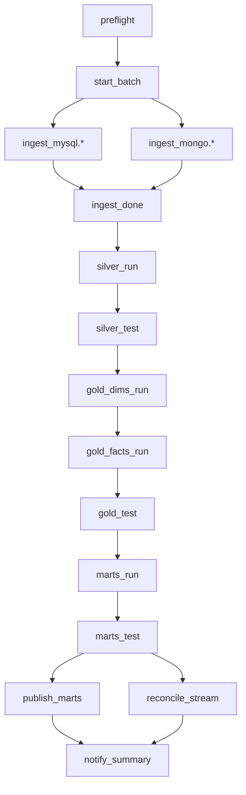

# Fleet Airflow runtime

Airflow decides **when** the Fleet pipeline runs; the repo scripts decide **what**
runs. Airflow never transforms data itself — every task shells out to a script
under `scripts/`, and those scripts write their own `control.*` / `audit.*` rows
so an Airflow run and a warehouse batch always tie back together.

This is the operational README: setup, commands, task flow, and troubleshooting.

---

## Contents

- [At a glance](#at-a-glance)
- [Prerequisites and configuration](#prerequisites-and-configuration)
- [Layout](#layout)
- [Start, inspect and stop the stack](#start-inspect-and-stop-the-stack)
- [Run the DAGs](#run-the-dags)
- [Daily DAG task flow](#daily-dag-task-flow)
- [Manual equivalents of each task](#manual-equivalents-of-each-task)
- [Helpers and templates](#helpers-and-templates)
- [How a run ties back to the warehouse](#how-a-run-ties-back-to-the-warehouse)
- [Testing and verification](#testing-and-verification)
- [Troubleshooting](#troubleshooting)
- [Safety rules](#safety-rules)

---

## At a glance

| Item | Value |
|---|---|
| Airflow version | `3.3.2` (pinned in `requirments-dev.txt` and the compose build arg) |
| Executor | `CeleryExecutor` with Redis broker and a dedicated worker |
| Services | `airflow-api-server`, `airflow-scheduler`, `airflow-dag-processor`, `airflow-worker`, `airflow-init`, `airflow-metadata`, `redis` |
| UI | `AIRFLOW_BASE_URL` (default `http://localhost:8080`) |
| Timezone | `Asia/Kolkata` for every DAG |
| Daily schedule | `0 2 * * *` (02:00 IST = 20:30 UTC previous day) |
| Pipeline name in `control.pipeline` | `fleet_daily` |
| Main DAG id | `fleet_daily_load` |
| Weekly DAG id | `fleet_report_weekly` (deliberate skeleton) |
| Watchdog DAG id | `fleet_watchdog` (15-minute stream health probe) |
| Cleanup DAG id | `fleet_batch_cleanup` (opt-in 15-minute stale-batch check) |
| DAGs at creation | paused (`AIRFLOW__CORE__DAGS_ARE_PAUSED_AT_CREATION=true`) |

> **Scope warning:** `fleet_report_weekly` still raises `NotImplementedError`
> until its payload policy is approved. `fleet_watchdog` is observational: it
> writes `audit.stream_health`, alerts on lag/freshness breaches and never
> opens or closes `control.batch`. `fleet_batch_cleanup` is opt-in and only
> fails `RUNNING` batches older than six hours when enabled.

---

## Prerequisites and configuration

Install Docker with Compose v2, `make`, and `uv`. Then create `.env` from the
tracked example and fill in real values:

```bash
cp .env.example .env
make env-check
```

Never commit `.env`. The image ships without credentials or secrets.

### Variables the stack requires

| Variable | Used for |
|---|---|
| `AIRFLOW_DB_PASSWORD` | Airflow metadata database and result backend (required by `compose.yml`) |
| `AIRFLOW_BASE_URL` | API server base URL and links in notifications (required by `compose.yml`) |
| `AIRFLOW_PORT` | Host port for the UI (default `8080`) |
| `AIRFLOW_VERSION` | Image tag suffix (default `3.3.2`) |
| `GIT_SHA` | Image provenance label |
| `AIRFLOW_UID` | Container user id (default `50000`) |
| `AIRFLOW__CORE__FERNET_KEY` | Encrypts secrets in the metadata DB; required by `airflow/scripts/init.sh` |
| `AIRFLOW_ADMIN_USERNAME`, `AIRFLOW_ADMIN_PASSWORD`, `AIRFLOW_ADMIN_EMAIL` | Admin account; required by `init.sh` |
| `AIRFLOW_ADMIN_FIRSTNAME`, `AIRFLOW_ADMIN_LASTNAME` | Admin display name (defaults `Admin` / `User`) |
| `MYSQL_POOL_SLOTS`, `MONGO_POOL_SLOTS` | Pool sizes created by `init.sh` (defaults `4` / `3`) |
| `DBT_TARGET` | dbt target used by `dbt_stage` tasks (default `dev`) |
| `FLEET_WEEKLY_REPORT_SCHEDULE` | Optional override of the weekly cron (default `0 9 * * 1`) |
| `FLEET_STALE_CLEANUP_ENABLED` | Allow `fleet_batch_cleanup` to fail stale batches (default `false`) |
| `FLEET_STALE_BATCH_MAX_AGE_HOURS` | Maximum `RUNNING` batch age before cleanup (default `6`) |

Generate a real Fernet key and put the value, unquoted, in `.env`:

```bash
uv run python -c "from cryptography.fernet import Fernet; print(Fernet.generate_key().decode())"
```

The `AIRFLOW__CORE__FERNET_KEY` line in `.env.example` is a placeholder, not a
usable key.

### Variables the pipeline preflight checks

The `preflight` task fails before opening a batch if any of these are missing
(`utils.engine.AIRFLOW_REQUIRED_ENV`):

```text
PG_HOST  PG_PORT  PG_DBNAME  PG_USER  PG_PASSWORD
MONGO_URI  MONGO_DB_NAME
MYSQL_HOST  MYSQL_PORT  MYSQL_USER  MYSQL_PASSWORD  MYSQL_DATABASE
DATABRICKS_HOST  DATABRICKS_HTTP_PATH  DATABRICKS_TOKEN
SMTP_HOST  SMTP_PORT  ALERT_EMAIL_FROM  ALERT_EMAIL_TO
DBT_TARGET
```

Preflight also opens Postgres, MySQL, MongoDB and Databricks connections and
runs `make contracts-check`.

### Container networking

`localhost` inside a container means the container itself. If MySQL, MongoDB,
Postgres or Databricks proxies run on the host, use an address reachable from the
containers (for example `host.docker.internal` on Docker Desktop) in `.env`.

### Alert delivery

Notifications use `ALERT_WEBHOOK_URL` and/or SMTP (`SMTP_*`, `ALERT_EMAIL_TO`,
`ALERT_EMAIL_FROM`). The Airflow SMTP settings are mapped through
`AIRFLOW__SMTP__*` in `.env`. All rendered text passes through
`helpers/scripts/redact.py` before it leaves the process.

---

## Layout

```text
airflow/
├── README.md                       # this file
├── Dockerfile                      # apache/airflow:<ver>-python3.13 image
├── compose.yml                     # service definitions
├── compose.dev.yml                 # local dev overrides (bind-mount the repo)
├── requirments-airflow.txt         # fab, celery, standard, redis providers
├── requirments-dev.txt             # pytest, ruff, jinja2, psycopg2, pendulum, Airflow
├── .gitignore
├── assets/
│   └── dbt_asset_keys.json         # committed manifest-keyed dbt asset outlets
├── dags/
│   ├── fleet_dbt_daliy.py          # fleet_daily_load: ingest -> dbt -> publish
│   ├── fleet_batch_cleanup.py      # opt-in stale-batch cleanup
│   ├── fleet_report_weekly.py      # fleet_report_weekly (skeleton)
│   └── fleet_watchdog.py           # fleet_watchdog (stream health probe)
├── helpers/
│   ├── scripts/                    # shared code imported by the DAGs
│   │   ├── prefilght.py            # env, connectivity and contract checks
│   │   ├── commads.py              # argv builders + redacted subprocess runner
│   │   ├── callbacks.py            # task/DAG failure and success hooks
│   │   ├── dbt_assets.py           # load committed dbt asset keys
│   │   ├── finalize_audit.py       # open/close control.batch rows
│   │   ├── auidt_reader.py         # read control/audit state, assert ingest done
│   │   ├── summary.py              # notification context builder
│   │   ├── notify.py               # webhook/email dispatch
│   │   └── redact.py               # strip secrets and PII before logging
│   └── template/                   # Jinja2 alerts
│       ├── summary.txt.j2
│       ├── summary.html.j2
│       ├── failure.txt.j2
│       └── failure.html.j2
├── scripts/
│   ├── entrypoint.sh               # image entrypoint (delegates to Airflow's)
│   ├── init.sh                     # db migrate, admin user, pools
│   └── healthcheck_worker.sh       # Celery worker probe
└── tests/                          # DAG structure and helper unit tests
```

`compose.dev.yml` bind-mounts the repository at `/opt/fleet` in every runtime
service, so DAG and helper edits are picked up without rebuilding the image.

---

## Start, inspect and stop the stack

Run all commands from the repository root. `--env-file .env` is required so
Compose interpolates the root `.env` while keeping the compose-relative build
context and bind mounts.

```bash
# Build and start (also runs airflow-init once)
make airflow-up

# Check service state
docker compose --env-file .env -f airflow/compose.yml -f airflow/compose.dev.yml ps

# Follow logs
docker compose --env-file .env -f airflow/compose.yml -f airflow/compose.dev.yml logs -f airflow-api-server
docker compose --env-file .env -f airflow/compose.yml -f airflow/compose.dev.yml logs -f airflow-scheduler airflow-dag-processor airflow-worker

# First-run diagnostics
docker compose --env-file .env -f airflow/compose.yml -f airflow/compose.dev.yml logs airflow-init

# Stop (keeps the metadata volume)
make airflow-down
```

On startup `airflow-init` runs `airflow db migrate`, creates the admin account
if absent, and sets `mysql_pool` / `mongo_pool`. The UI is available at
`AIRFLOW_BASE_URL`; log in with `AIRFLOW_ADMIN_USERNAME` /
`AIRFLOW_ADMIN_PASSWORD`.

---

## Run the DAGs

### From the UI

1. Open `AIRFLOW_BASE_URL` and sign in.
2. **DAGs** → `fleet_daily_load` → toggle **Unpause** (DAGs start paused).
3. Click **Trigger DAG**, optionally supply config, then **Trigger**.
4. Watch the **Grid** view; click a task square → **Log** for redacted output.

### From the CLI

The scheduler container has the Airflow CLI and the same `.env`/`PYTHONPATH`
as the rest of the stack:

```bash
# List DAGs
docker compose --env-file .env -f airflow/compose.yml -f airflow/compose.dev.yml exec airflow-scheduler airflow dags list

# List tasks of the daily DAG
docker compose --env-file .env -f airflow/compose.yml -f airflow/compose.dev.yml exec airflow-scheduler airflow tasks list fleet_daily_load

# Unpause so the daily schedule is active
docker compose --env-file .env -f airflow/compose.yml -f airflow/compose.dev.yml exec airflow-scheduler airflow dags unpause fleet_daily_load

# Trigger now (Airflow generates the run id)
docker compose --env-file .env -f airflow/compose.yml -f airflow/compose.dev.yml exec airflow-scheduler airflow dags trigger fleet_daily_load

# Trigger with a stable, recognisable run id
docker compose --env-file .env -f airflow/compose.yml -f airflow/compose.dev.yml exec airflow-scheduler airflow dags trigger fleet_daily_load --run-id manual_fleet_validation_001

# Pause again when finished
docker compose --env-file .env -f airflow/compose.yml -f airflow/compose.dev.yml exec airflow-scheduler airflow dags pause fleet_daily_load
```

The `--run-id` value is written to `control.batch.airflow_run_id`, so using a
descriptive id makes the warehouse rows easy to find.

Inspect pools and users if setup looks incomplete:

```bash
docker compose --env-file .env -f airflow/compose.yml -f airflow/compose.dev.yml exec airflow-scheduler airflow pools list
docker compose --env-file .env -f airflow/compose.yml -f airflow/compose.dev.yml exec airflow-scheduler airflow users list
```

---

## Daily DAG task flow



| Task id | What it runs | Notes |
|---|---|---|
| `preflight` | `run_preflight()` | 1 retry; checks env, four connections, contracts |
| `start_batch` | `control.start_batch` | Batch id passed by XCom to all downstream tasks |
| `ingest_mysql.<table>` | `scripts/ingestion.py` | `mysql_pool`, 2 retries with 5→30 min backoff, 45 min timeout |
| `ingest_mongo.<table>` | `scripts/ingestion.py` | `mongo_pool`, same retry/timeout policy |
| `ingest_done` | `assert_ingestion_complete()` | Fails if any contract table has no successful audit row |
| `silver_run` | `scripts/run_dbt.py run --select path:models/silver` | 60 min timeout |
| `silver_test` | `scripts/run_dbt.py test --select path:models/silver` | `--indirect-selection cautious` |
| `gold_dims_run` | `scripts/run_dbt.py run --select dim_*` | Current-state SCD1 dimensions; snapshots exist but are not wired |
| `gold_facts_run` | `scripts/run_dbt.py run --select fct_*` | Facts join the current SCD1 dimension row |
| `gold_test` | `scripts/run_dbt.py test --select dim_* fct_*` | Excludes `assert_marts_reconcile_to_facts` until marts exist |
| `marts_run` | `scripts/run_dbt.py run --select mart_*` | |
| `marts_test` | `scripts/run_dbt.py test --select mart_* assert_marts_reconcile_to_facts` | Reconciles marts to facts |
| `publish_marts` | `scripts/publish_marts.py` | 1 retry after 10 min, 90 min timeout; only the approved allow-list |
| `reconcile_stream` | `scripts/stream_reconcile.py` | Observational stream-vs-gold audit rows; drift never fails the DAG |
| `notify_summary` | `finalize_batch(..., "SUCCEEDED")` + `send_run_summary()` | Runs with `all_done` once both branches finish |

DAG limits: `max_active_runs=1`, `catchup=False`, `dagrun_timeout=6h`,
owner `fleet-data-eng`, tags `fleet` / `daily`. The dbt `run` tasks publish
manifest-keyed assets loaded from `assets/dbt_asset_keys.json`; regenerate the
map with `make dbt-asset-keys` and verify it with `make dbt-asset-keys-check`
after `make dbt-parse ENV=ci`.

### Ingestion order

MySQL loads are tiered; a tier starts only after its dependencies succeed.
MongoDB tables are independent of the MySQL tiers.

| Source | Tier | Tables |
|---|---|---|
| mysql | 1 | `drivers`, `trucks`, `trailers`, `customers`, `routes`, `facilities` |
| mysql | 2 | `loads` (needs tier 1) |
| mysql | 3 | `trips` (needs tier 1 + `loads`) |
| mysql | 4 | `fuel_purchases` (needs tier 1 + `trips`; contract references `trips.trip_id`) |
| mongo | 1 | `delivery_events`, `maintenance_records`, `safety_incidents` |

All ingestion tasks run after `start_batch`; `ingest_done` is the barrier before
any dbt work starts.

---

## Manual equivalents of each task

These are the exact commands the DAG builds (with shell quoting added for
wildcards). Use them for debugging one stage, from the repository root with
`.env` loaded. Replace `<batch_id>` and `<run_id>` with real values; omit
`--batch-id` if you deliberately want an unlinked standalone run.

```bash
# One source table -> bronze (the DAG runs one process per table)
uv run --no-sync python scripts/ingestion.py \
  --source mysql --table drivers \
  --batch-id <batch_id> \
  --airflow-dag-id fleet_daily_load --airflow-run-id <run_id>

# Silver
uv run --no-sync python scripts/run_dbt.py run --target dev \
  --select 'path:models/silver' \
  --batch-id <batch_id> --airflow-dag-id fleet_daily_load --airflow-run-id <run_id>

# Gold dimensions, then facts
uv run --no-sync python scripts/run_dbt.py run --target dev \
  --select 'dim_*' \
  --batch-id <batch_id> --airflow-dag-id fleet_daily_load --airflow-run-id <run_id>
uv run --no-sync python scripts/run_dbt.py run --target dev \
  --select 'fct_*' \
  --batch-id <batch_id> --airflow-dag-id fleet_daily_load --airflow-run-id <run_id>

# Gold tests (late mart reconciliation is excluded here)
uv run --no-sync python scripts/run_dbt.py test --target dev \
  --indirect-selection cautious \
  --select 'dim_*' 'fct_*' --exclude assert_marts_reconcile_to_facts \
  --batch-id <batch_id> --airflow-dag-id fleet_daily_load --airflow-run-id <run_id>

# Marts and their tests
uv run --no-sync python scripts/run_dbt.py run --target dev \
  --select 'mart_*' \
  --batch-id <batch_id> --airflow-dag-id fleet_daily_load --airflow-run-id <run_id>
uv run --no-sync python scripts/run_dbt.py test --target dev \
  --indirect-selection cautious \
  --select 'mart_*' assert_marts_reconcile_to_facts \
  --batch-id <batch_id> --airflow-dag-id fleet_daily_load --airflow-run-id <run_id>

# Publish approved marts to Databricks (writes to the Databricks gold copy)
uv run --no-sync python scripts/publish_marts.py \
  --batch-id <batch_id> --airflow-dag-id fleet_daily_load --airflow-run-id <run_id>
```

`commads.py` builds these as argv lists and runs them without a shell; stdout
and stderr are passed through `redact.py` before being logged.

To run the pipeline without Airflow at all, use the Makefile entry points
(`make help` lists them):

```bash
make env-check
make contracts-check
make ingest
make dbt-build ENV=dev
make dbt-test ENV=dev
make publish-marts
```

`make publish-marts` writes to Databricks; use it only when that publish is
intended. Production operations additionally require `ENV=prod CONFIRM=yes`.

---

## Helpers and templates

| Helper | Used by | Purpose |
|---|---|---|
| `prefilght.py` | `preflight` | Fail fast on missing env vars, dead connections or contract drift |
| `commads.py` | every task | Construct exact `uv run --no-sync python scripts/...` argv; run with redacted output |
| `callbacks.py` | task/DAG callbacks | On failure, close the batch and send an alert; on success, send the digest |
| `dbt_assets.py` | `fleet_daily_load` dbt run tasks | Load committed manifest-keyed asset outlets |
| `finalize_audit.py` | `start_batch`, `notify_summary`, callbacks, cleanup | Open and close `control.batch`, fail stale batches, resolve open errors |
| `auidt_reader.py` | `ingest_done`, summaries | Read `control.batch` / `audit.task_run_log`, assert all sources landed |
| `stream_health.py` | `fleet_watchdog` | Read the latest `audit.stream_health` watchdog row for breach alerts |
| `summary.py` | notifications | Build the context dict for the Jinja templates |
| `notify.py` | `notify_summary`, callbacks | Send via webhook and/or email |
| `redact.py` | all log/notify paths | Strip tokens, passwords, PII salt and row values |

Templates live in `helpers/template/`: `summary.txt.j2` / `summary.html.j2`
for successful runs and `failure.txt.j2` / `failure.html.j2` for failures.

---

## How a run ties back to the warehouse

```text
Airflow run                          Postgres
───────────                          ────────
dag_id         ───────────────────►  control.batch.airflow_dag_id
run_id         ───────────────────►  control.batch.airflow_run_id
logical_date   ───────────────────►  control.batch.logical_date

task start     ───────────────────►  audit.task_run_log (RUNNING)
task end       ───────────────────►  audit.task_run_log (SUCCEEDED | FAILED)
any error      ───────────────────►  audit.error_log
dbt done       ───────────────────►  audit.dbt_invocation + dbt_run_results
                                     + data_quality_results
batch end      ───────────────────►  control.finish_batch(status, message)
```

A failed task closes its batch through `finalize_audit.py` in the failure
callback; `fleet_batch_cleanup` is the safety net for crashed workers when
`FLEET_STALE_CLEANUP_ENABLED=true` (default `false`, max age 6 hours). Retry
only transient connection errors — a contract or data-test failure stays broken
until the data or logic is fixed.

---

## Testing and verification

```bash
# Airflow orchestration tests (helper units; DAG-import tests skip without airflow.sdk)
make airflow-test

# Repository quality gates
make lint-fast
make py-test
make py-cov
make contracts-check
make dbt-parse ENV=ci && make dbt-asset-keys-check
```

Direct pytest invocation collects all 44 Airflow tests, while `make airflow-test`
runs the subset listed in the Makefile:

```bash
PYTHONPATH=airflow uv run --no-sync pytest airflow/tests
```

`PYTHONPATH=airflow` is required outside the image so `helpers.*` imports
resolve; inside the containers the full path is set by the `Dockerfile`. The
root suite collects 186 tests, so the combined Python/Airflow total is 230.

---

## Troubleshooting

| Symptom | Check |
|---|---|
| DAG does not appear | `logs airflow-dag-processor`; confirm `compose.dev.yml` mounts the repo at `/opt/fleet` |
| DAG exists but never runs on schedule | It is paused at creation; `airflow dags unpause fleet_daily_load` |
| `preflight failed: <names>` | Add the listed variables to `.env`; names only are reported, never values |
| `pool not found` | `airflow-init` did not finish; inspect its log and run `airflow pools list` |
| UI or API unhealthy | `AIRFLOW_BASE_URL`, `AIRFLOW_PORT`, and `logs airflow-api-server` |
| Tasks fail to reach the warehouse | Use a container-reachable host, not `localhost`, in `.env` |
| Contract or dbt test failure | Fix the contract/data logic; do not weaken the test or blindly retry |
| Weekly task fails immediately | Expected: `fleet_report_weekly` is still a deliberate skeleton |
| `fleet_batch_cleanup` does nothing | `FLEET_STALE_CLEANUP_ENABLED` defaults to `false`; check the flag and batch age |
| Watchdog reports no health | Check `control.stream` is `ENABLED` and Kafka is reachable |
| Stream breach alert received | Inspect `audit.stream_health` and replay/reset the speed layer; gold remains authoritative |
| Metadata needs a clean reset | `docker compose ... down -v` deletes `airflow-metadata` and all run history — destructive |

---

## Safety rules

- Never commit `.env`, tokens, passwords, connection strings or the PII salt.
- Airflow writes no data layer; only the scripts write `bronze` / `silver` /
  `gold` / marts, and only the sync writes the Databricks gold copy.
- Production deploys use an immutable `sha-<commit>` image; no `latest` tag.
- Do not disable contracts, `on_schema_change: fail`, dlt `freeze`, tests or
  checks to make a run green.
- Do not run `--full-refresh`, backfills, or Databricks/production operations
  without explicit approval.

## References

- [`README.md`](../README.md) — repository overview and full command list
- [`AGENTS.md`](../AGENTS.md) — repository permissions and conventions
- [`Makefile`](../Makefile) — `make help` for every supported entry point
