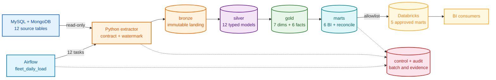

# Architecture guide

**Purpose:** Explain the current data flow, ownership boundaries, idempotency model, and failure path of the Fleet dbt Warehouse.

**Audience:** Engineers, reviewers, and analysts who need to understand where a value is created and who may change it.

[Back to README](../README.md) · [Authoritative architecture](../ARCHITECTURE.md)

This guide is a short companion to the root architecture document. If they disagree, the root document wins.

## Data flow

| Colour | Layer | Writer |
|---|---|---|
| Blue (`#e3f2fd`) | Source | MySQL and MongoDB |
| Orange (`#fff3e0`) | Bronze | `scripts/ingestion.py`, `scripts/load_fixtures.py` |
| Purple (`#f3e5f5`) | Silver | dbt |
| Green (`#e8f5e9`) | Gold | dbt |
| Teal (`#e0f7fa`) | Marts | dbt |
| Yellow (`#fff8e1`) | Serving | `scripts/publish_marts.py`, BI tools |
| Pink (`#fce4ec`) | Control / audit | SQL functions, Python, Airflow |
| Light blue (`#e1f5fe`) | Orchestration | Airflow |

## Ownership

| Schema | Written only by | Reason |
|---|---|---|
| `bronze` | Ingestion and fixture loader | Raw landed rows must remain unchanged before silver. |
| `silver` | dbt | One typed model per bronze table; no business joins. |
| `gold` | dbt | Business keys, conformed dimensions, facts, and PII rules. |
| `marts` | dbt | Denormalised grains for BI and publication. |
| Databricks `marts` copy | `scripts/publish_marts.py` | Read-only serving copy. |
| `control`, `audit` | `control.*` functions, Python, SQL triggers, Airflow | Run state and evidence cannot be edited by dbt. |

## Design choices and trade-offs

| Choice | Trade-off |
|---|---|
| dbt owns transformations; Python only moves data | One testable lineage; more data lands in `bronze` before it is shaped. |
| Watermark micro-batches with lookback | Handles late and changed rows without full reloads; watermark resets and reprocessing windows need monitoring. |
| SCD1 current-state dimensions | Simple, fast BI; no historical attribution until snapshots/SCD2 are added. |
| Published-mart allowlist | Prevents PII or unreviewed models reaching Databricks; new grains require a reviewed PR. |
| Airflow decides when, scripts decide what | Local, CI, and DAG runs use the same commands; DAG code holds no transformation logic. |

## Sensitive-data boundaries

| Value | Handling |
|---|---|
| `drivers.license_number` | Hashed into a derived value; raw value does not reach marts. |
| `drivers.date_of_birth` | Converted to an age attribute in silver/gold; not in marts. |
| `drivers.first_name`, `last_name` | Kept in Postgres only; the driver scorecard mart is not published. |
| `fuel_purchases.fuel_card_number` | Masked to the last four digits. |
| `safety_incidents.description` | Excluded from gold and published marts. |

## Replay and failure behaviour

- Ingestion upserts on contract primary keys and advances watermarks only after a successful write and reconciliation.
- Silver and facts reprocess a lookback window keyed on load timestamps; rerunning the same input is safe.
- Failed contract or data tests block downstream stages; retries are for transient connection errors only.
- `control.batch` keeps run state, while `audit.*` stores task, dbt, quality, reconciliation, and error evidence.
- Failed batches emit `pg_notify('pipeline_failure', …)` and a redacted operator notification.

## Current gaps

- dbt model contracts are not enforced, and incremental models use `append_new_columns`.
- There are no dbt unit tests or snapshots committed.
- Airflow assets, scheduled stale-batch cleanup, and weekly/watchdog DAG bodies are not implemented.
- `SOURCE_MODE` is not a unified switch; fixture loading is a separate guarded script.

Related: [deployment guide](DEPLOYMENT.md), [dbt guide](DBT.md), [testing guide](TESTING.md), [decision records](adr/).
