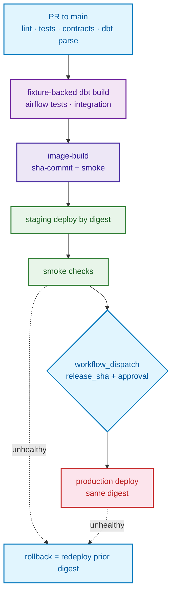

# Deployment guide

**Purpose:** Describe how the project is installed, tested, imaged, promoted, and operated.

**Audience:** Engineers and operators setting up local/CI runs, deploying images, or responding to a failed run.

[Back to README](../README.md) · [Authoritative deployment guide](../DEPLOYMENT.md)

This guide is a short companion to the root deployment document. If they disagree, the root document wins.

## Environments

| Environment | Warehouse/database | dbt target | Trigger | Approval |
|---|---|---|---|---|
| Demo | `fleet_dev`, `ci_demo_*` schemas | `ci` | `make demo` | None; uses fixture samples and placeholder credentials |
| Local dev | `PG_DBNAME` from local config | `dev` | Manual `make` targets | `CONFIRM=yes` for destructive actions |
| CI | `fleet_dev`, `ci_pr_<n>_*` schemas | `ci` | PR and push to `main` | Automatic; guarded by DB-name checks |
| Staging | Host `.env` | Runtime `DBT_TARGET` | Successful CI on `main` | Automatic, then smoke checks |
| Production | Host `.env` | Runtime `DBT_TARGET` | Manual `workflow_dispatch` | GitHub `production` environment reviewers |

`ENV` in Make means the dbt target (`dev|ci|prod`), not the deployment environment. Production commands require `ENV=prod CONFIRM=yes` and explicit approval.

## Promotion flow



`.github/workflows/ci.yml` has seven jobs: `lint`, `unit-tests`, `contracts`, `dbt-parse`, `airflow-test`, `integration`, and `image-build`. `.github/workflows/leaks.yml` runs Gitleaks on PRs, pushes to `main`, a weekly schedule, and manual dispatch. `.github/workflows/deploy.yml` resolves a 40-character commit SHA to a GHCR digest and never deploys `latest`.

## Local setup and verification

```bash
make demo
```

`make demo` is the zero-credential path: it checks placeholders, validates contracts, bootstraps `audit`/`control`, lands the 12 sample payloads, and builds 32 models plus 383 dbt tests in `ci_demo_*` schemas on local `fleet_dev`. Docker is not required.

For a full local installation, use `make help`, `make install`, `make env-check`, `make lint-fast`, `make py-test`, and `make contracts-check`. Start the optional Airflow UI with `make airflow-up` after supplying a real local config; never commit or modify `.env`.

## Runtime topology

Airflow Compose services are `airflow-init`, `airflow-api-server`, `airflow-scheduler`, `airflow-dag-processor`, `airflow-worker`, `airflow-metadata`, and `redis`. The worker runs repository scripts: ingestion → dbt → publication. Connections and pools are prepared by `airflow/scripts/init.sh`; DAGs are paused at creation until an operator unpauses `fleet_daily_load`.

## Required secrets

| Scope | Names | Used by |
|---|---|---|
| CI | `GITHUB_TOKEN` (automatic) | GHCR login |
| Staging | `STAGING_SSH_KEY`, `STAGING_DEPLOY_HOST`, `STAGING_DEPLOY_USER`, `STAGING_DEPLOY_PATH` | `deploy-staging`, `smoke-staging` |
| Production | `PRODUCTION_SSH_KEY`, `PRODUCTION_DEPLOY_HOST`, `PRODUCTION_DEPLOY_USER`, `PRODUCTION_DEPLOY_PATH` | `deploy-production`, `smoke-production` |
| Hosts | `.env` on each remote host | Compose runtime configuration |

The workflow maps `STAGING_SSH_KEY`/`PRODUCTION_SSH_KEY` into the `SSH_PRIVATE_KEY` input for `scripts/deploy.sh`. Secrets are never written into the image or repository.

## Guardrails

- Conventional Commit messages and a 72-character subject cap are checked by `.githooks/commit-msg`.
- `.githooks/pre-push` compiles Python and validates contract JSON.
- CI blocks merges on lint, unit tests, contracts, dbt parse, Airflow structure, integration, fixture build, and image smoke failures.
- Makefile targets require `CONFIRM=yes` for destructive, production, full-refresh, and deploy actions.
- Images are tagged `sha-<commit>` and deployed by digest; rollback is a redeploy of a known digest.
- Failed contract or data tests are never retried automatically or downgraded to pass CI.

## Operational checks after deploy

- Airflow API health and scheduler job check pass.
- `fleet_daily_load` is unpaused and the next run is visible.
- `control.batch` has at most one `RUNNING` row per pipeline and matches the Airflow run id.
- `audit.v_batch_summary` shows the expected ingest tasks, dbt invocation, and publish reconciliation.
- Five Databricks marts exist with expected schemas; the driver scorecard is absent.
- Notification output is redacted and delivered.

## Current gaps

- Only `ci.yml`, `deploy.yml`, and `leaks.yml` exist; release, cleanup, nightly, and GitHub Pages workflows are not tracked.
- `make ci` is a local alias for `verify`; GitHub Actions is the real pipeline.
- No coverage gate, dbt unit tests, or snapshots are configured.
- Airflow assets are not derived from the dbt manifest.
- The committed devcontainer references are broken; use `make airflow-up` instead.

Related: [architecture guide](ARCHITECTURE.md), [dbt guide](DBT.md), [testing guide](TESTING.md), [decision records](adr/), [screenshot plan](SCREENSHOTS.md).
