# Fleet Analytics Insight

## Executive summary
- **Revenue is moderately concentrated:** the top customer (First Group) generated $9,136,680 (3.5% of load revenue), and the top 10 customers generated 19.8%; top lane Philadelphia, PA to Seattle, WA generated $10,069,054 (3.8% of total load revenue).
- **Delivery service is the main operational gap:** overall on-time rate was 55.7% across 170,820 delivery events, with Atlanta Distribution Center lowest among high-volume facilities at 53.4%; estimated detention cost totaled $19,545,578 at $75/hour.
- **Fuel efficiency varies little by age band in observed trips:** MPG ranged from 6.42 (3-5 years) to 6.45 (11+ years), a 0.42% gap; highest average fuel price among high-volume states was NE at $3.91/gallon.
- **Maintenance cost per truck is highest in the 3-5 year band, but that band has only 1 truck:** 3-5 years cost $70,708/truck vs 11+ years $46,985/truck (0.66x). All age bands exceeded replacement thresholds ($15,000/truck or 80 downtime hours/truck).
- **Safety risk is concentrated in mid-career cohorts:** 170 incidents produced $2,653,172 in claim amount; 37.6% were preventable. Highest claim-cost bands were 10-19 years experience ($1,207,645) and 6-10 years tenure ($1,167,470).

## 1) Revenue concentration
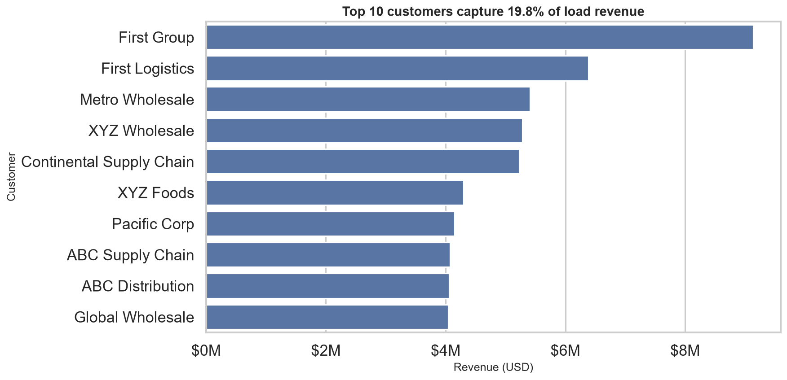
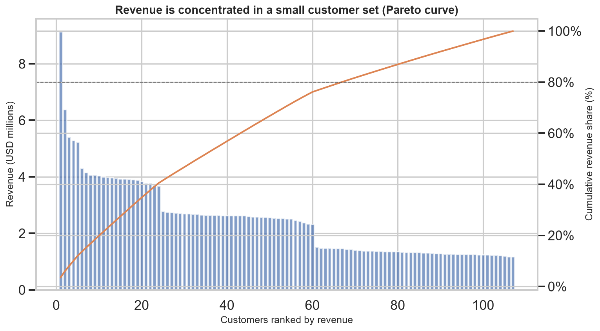
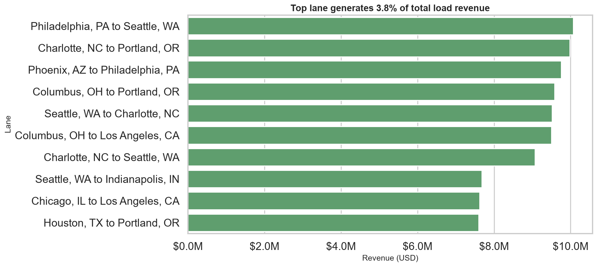
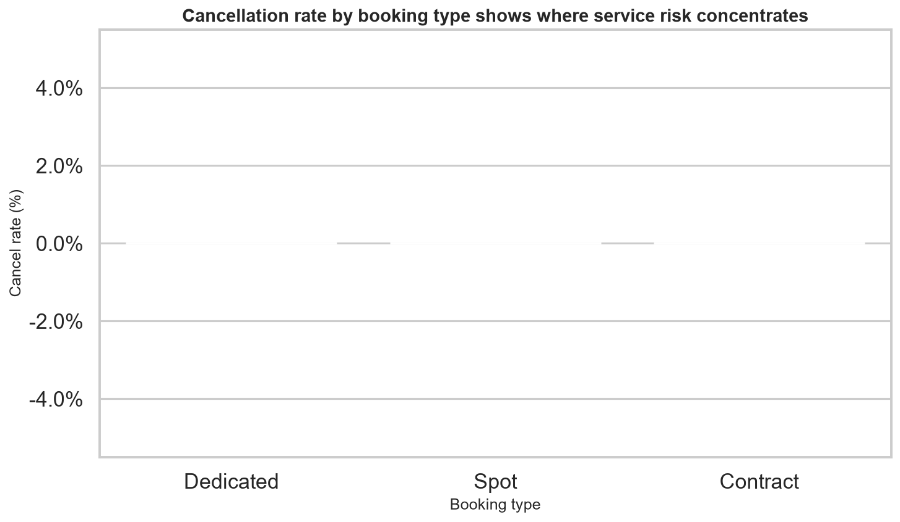

**Finding:** Top customer First Group represented 3.5% of load revenue ($9,136,680); top 10 customers represented 19.8%. The top lane, Philadelphia, PA to Seattle, WA, represented 3.8% ($10,069,054). Cancel rates were 0.0% for Dedicated (42,337 loads), Spot (21,528 loads), and Contract (21,545 loads).

**Why it matters:** Revenue is spread across many customers, but the largest accounts and lanes still create concentration risk and negotiation leverage.

**Recommendation:** Protect top-customer and top-lane service levels with explicit SLAs; use lane profitability review before adding capacity on Philadelphia, PA to Seattle, WA.

## 2) Delivery service
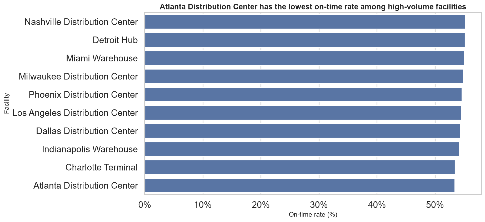
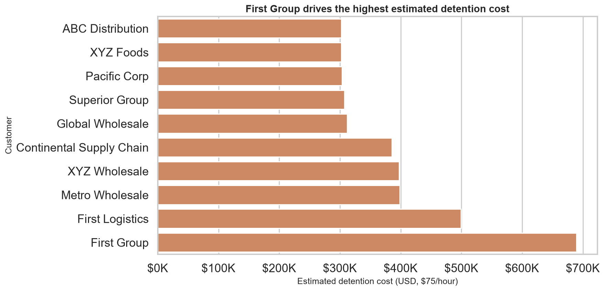

**Finding:** Overall on-time rate was 55.7% (170,820 known on-time events; unknown on-time rate 0.0%). Lowest high-volume facility was Atlanta Distribution Center at 53.4% (3,278 events, $379,249 estimated detention). Highest detention-cost customer was First Group at $689,352 (6,002 events, 55.8% on-time).

**Why it matters:** On-time performance below target and detention charges directly erode margin and customer trust.

**Recommendation:** Prioritize root-cause review at Atlanta Distribution Center and renegotiate/operationalize dwell limits for First Group appointments.

## 3) Fuel efficiency
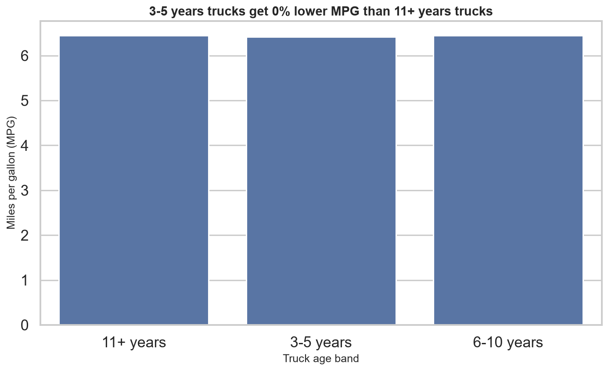
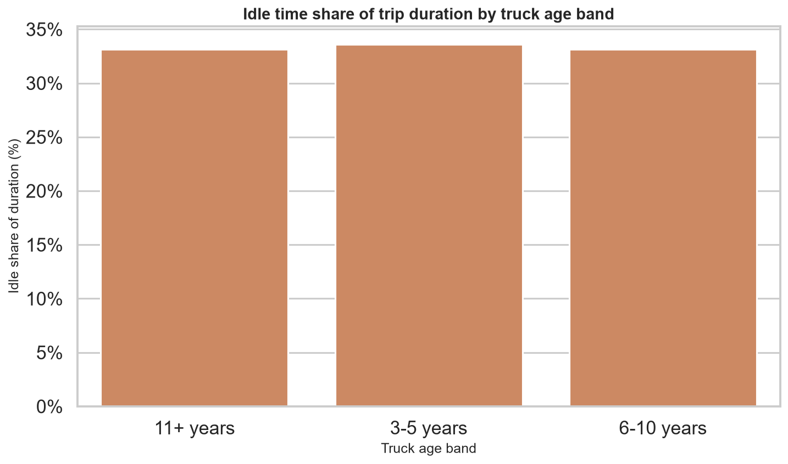
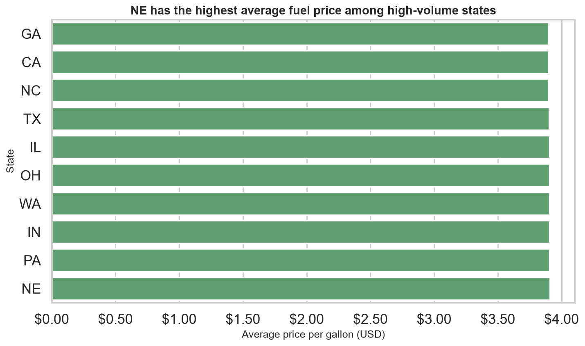

**Finding:** Among consistent trips (85,410 of 85,410; inconsistent 0, unknown 0), MPG was 6.45 for 11+ years and 6.42 for 3-5 years (0.42% gap). Idle share was 33.2% (11+ years) and 33.6% (3-5 years). Highest average fuel price among high-volume states was NE at $3.91/gallon (7,770 purchases).

**Why it matters:** Fuel spend is driven more by price and idle behavior than by small MPG differences across age bands.

**Recommendation:** Target idle reduction coaching and route/fueling policies in high-price states, starting with NE.

## 4) Fleet maintenance
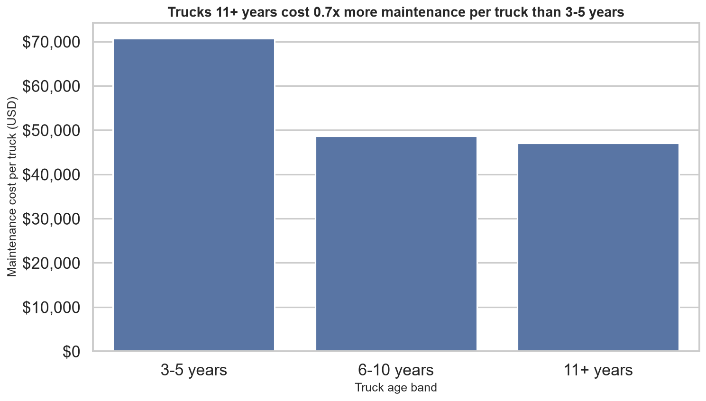
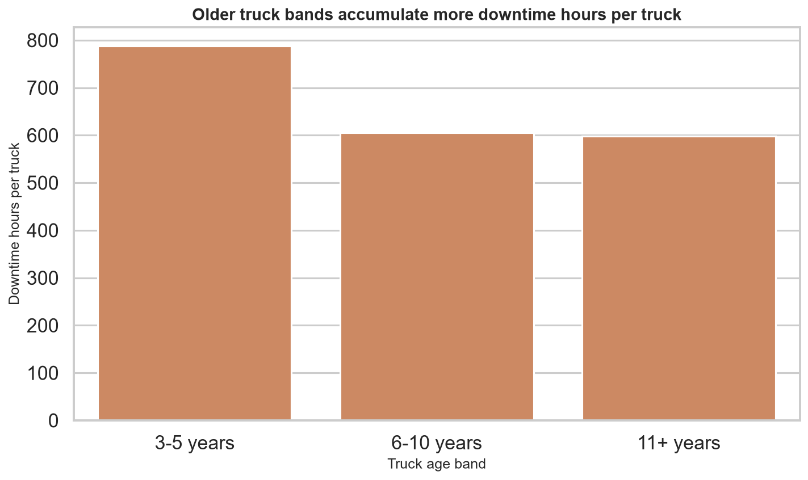

**Finding:** Using consistent maintenance rows (2,920 of 2,920; inconsistent 0, unknown 0), maintenance cost per truck was $70,708 for 3-5 years (1 truck, 32 events), $48,660 for 6-10 years (41 trucks), and $46,985 for 11+ years (78 trucks). Downtime per truck was 787.9, 605.7, and 597.5 hours respectively. Replacement-flagged bands by thresholds: 3-5 years, 6-10 years, 11+ years.

**Why it matters:** Maintenance and downtime create capacity and cost risk; the 3-5 year signal is not reliable due to sample size.

**Recommendation:** Use truck-level cost/downtime thresholds for replacement decisions; gather more 3-5 year observations before treating that band as a benchmark.

## 5) Safety
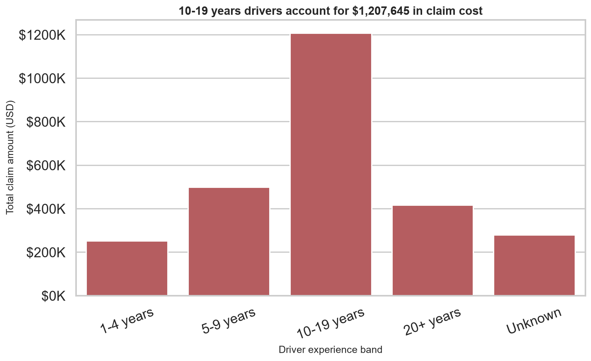
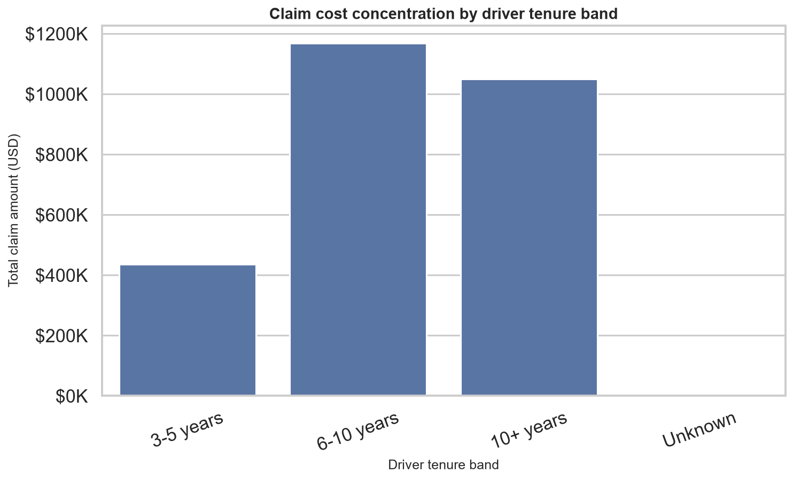
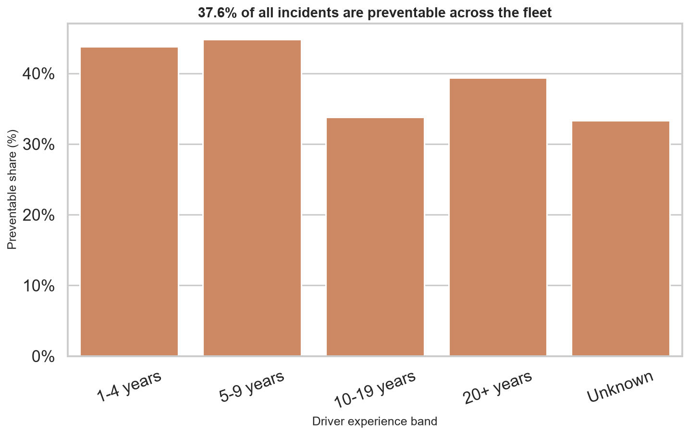

**Finding:** 170 incidents generated $2,653,172 total claim amount; 64 (37.6%) were preventable. Highest claim-cost experience band was 10-19 years with $1,207,645 across 74 incidents (33.8% preventable). Highest claim-cost tenure band was 6-10 years with $1,167,470 across 73 incidents.

**Why it matters:** Preventable incidents are a controllable cost and safety exposure.

**Recommendation:** Focus coaching on preventable incident patterns in 10-19 years experience and 6-10 years tenure cohorts; track claim cost per incident after interventions.

## 6) Seasonality
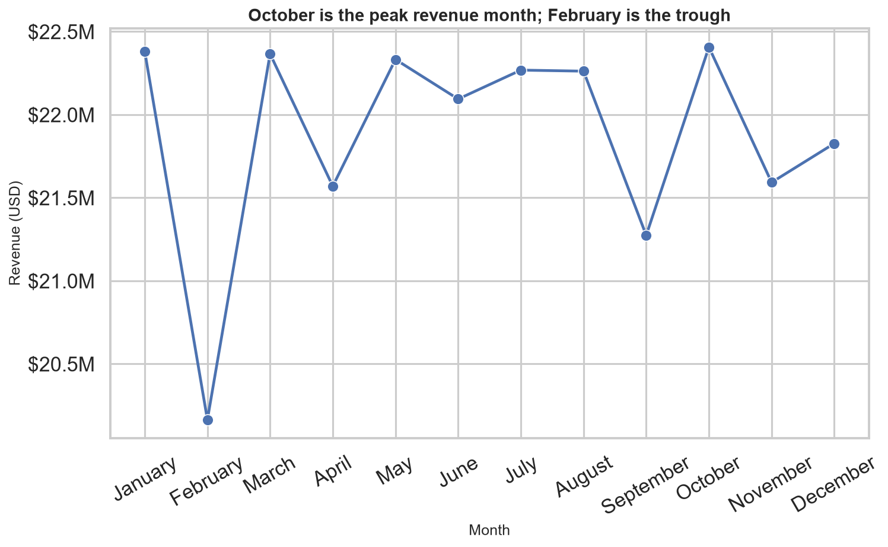
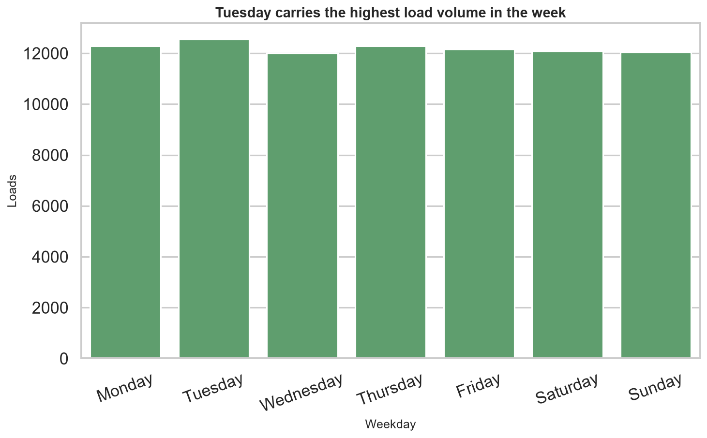

**Finding:** Peak month was October with $22,405,461 revenue and 7,339 loads; lowest month was February with $20,163,263 and 6,582 loads. Peak weekday by loads was Tuesday (12,544 loads, $38,464,807); lowest was Sunday (12,043 loads, $36,906,049).

**Why it matters:** Planning staffing, maintenance windows, and capacity against predictable peaks reduces service misses and overtime.

**Recommendation:** Align capacity and maintenance scheduling to October and Tuesday peaks; use February/Sunday for planned downtime where possible.

## 7) Data quality
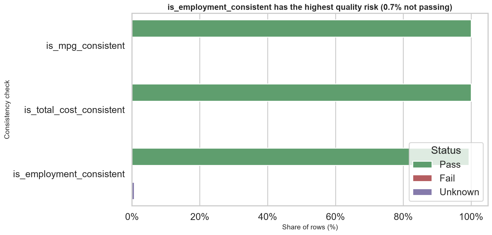

**Finding:** Consistency checks passed fully for fct_trips.is_mpg_consistent (85,410/85,410 pass), fct_fuel_purchases.is_total_cost_consistent (196,442/196,442), and fct_maintenance.is_total_cost_consistent (2,920/2,920). dim_drivers.is_employment_consistent had 1 unknown row of 151 (0.66% unknown, 0.00% fail).

**Why it matters:** Reliable consistency flags allow scripts to exclude suspect rows and avoid overstating confidence.

**Recommendation:** Investigate the unknown driver employment-consistency record; keep consistency filters in reporting scripts.

## Data quality notes
- `fct_trips`: filtered to `is_mpg_consistent=true` for MPG/idle aggregates; 0 inconsistent, 0 unknown of 85,410 rows.
- `fct_fuel_purchases`: filtered to `is_total_cost_consistent=true` for fuel price aggregates; 0 inconsistent, 0 unknown of 196,442 rows.
- `fct_maintenance`: filtered to `is_total_cost_consistent=true`; 0 inconsistent, 0 unknown of 2,920 rows.
- `dim_drivers`: `is_employment_consistent` has 1 unknown / 0 fail of 151 rows; driver rows were used as dimension attributes.
- `fct_delivery_events`: no `*_consistent` column; null `on_time_flag` excluded from on-time denominators and reported (0.0% unknown).
- `fct_loads`, `fct_safety_incidents`: no `*_consistent` columns; all rows included; null `preventable_flag` treated as not preventable in safety share.

## Methodology
- **Tables:** `dim_date`, `dim_customers`, `dim_drivers`, `dim_trucks`, `dim_trailers`, `dim_facilities`, `dim_routes`, `fct_loads`, `fct_trips`, `fct_delivery_events`, `fct_fuel_purchases`, `fct_maintenance`, `fct_safety_incidents` (gold schema).
- **Date range:** load dates 2022-01-01 to 2024-12-31 (from `fct_loads` joined to `dim_date`).
- **Aggregation:** SQL in Postgres for all aggregations; only aggregated results pulled into pandas.
- **Filters/caveats:** Unknown dimension members (`*-1`) excluded where they would distort labels. High-volume facility/state thresholds used in scripts (>=100 events/purchases). Detention cost estimated at $75/hour. Maintenance 3-5 year band has 1 truck / 32 events and should not be over-interpreted. No DB writes; scripts emit PNGs and findings JSON only.
